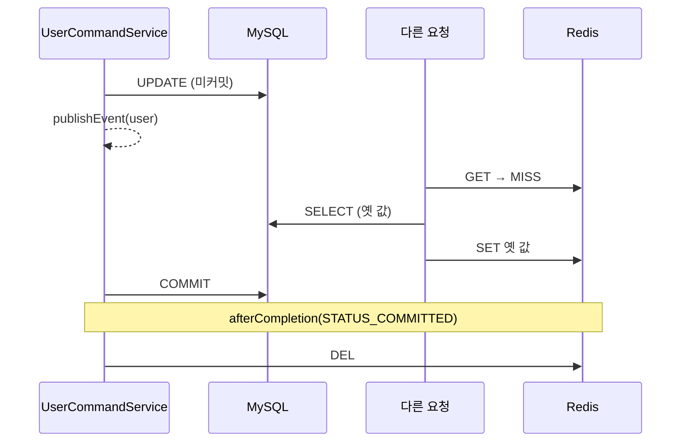

# After Commit Invalidate

커밋이 확정된 뒤에만 캐시를 지운다.
앞선 [write-invalidate](../write-invalidate/README.md) 가 "언제 지우는가" 를 비교했다면,
이 모듈은 그 중 **커밋 이후** 를 스프링이 주는 선언 하나로만 구현하고
그 선언이 **어디서 조용히 작동하지 않는지** 를 고정한다.

```java
// 쓰기: 바뀐 엔티티를 그대로 발행
user.changeEmail(email);
eventPublisher.publishEvent(user);

// 소비: CacheEvictable 이면 엔티티가 밝힌 키를 커밋 이후에 지운다
@TransactionalEventListener(phase = TransactionPhase.AFTER_COMMIT)
public void evict(CacheEvictable entity) {
	entity.cacheKeys().forEach(this::evictOne);
}
```

쓰기 코드는 바뀐 엔티티를 알리기만 하고, 지우는 일은 이 리스너가 맡는다.
Spring 이 엔티티를 `PayloadApplicationEvent` 로 감싸 `CacheEvictable` 구현체만 리스너에 넘긴다.
지울 키는 엔티티가 안다. 리스너는 어느 캐시인지 모르므로 엔티티가 늘어도 그대로다.
코어 모듈을 쓰지 않고, 하이버네이트 엔티티 이벤트도 받지 않는다. 증명 대상이 그 선언 자체이기 때문이다.

## Environment

- Java 21
- Spring Boot 3.5.0
- Spring Framework 6.2.7
- Hibernate 6.6.15.Final
- MySQL 8.4.4
- Redis 7
- Testcontainers 1.21.3

## 동작



커밋 전에 끼어든 조회가 옛 값을 다시 심어도 삭제가 그 뒤에 오므로 함께 걷어낸다.

## 보장하는 것

| 상황 | 결과 |
|-----|-----|
| 커밋 성공 | 옛 값이 지워진다 (삭제·수정 모두) |
| 커밋 전 | 캐시를 건드리지 않는다 |
| 커밋 전에 끼어든 조회 | 그 조회가 적재한 옛 값까지 지워진다 |
| 롤백 | 지우지 않는다 |

## 보장하지 않는 것

| 항목 | 모듈이 고정한 동작 |
|-----|----------------|
| **발행 시점에 트랜잭션이 없는 경로** | 이벤트가 **폐기된다.** DB 만 바뀌고 캐시에 옛 값이 남는다 |
| 중복 제거 | 한 트랜잭션에서 두 번 알리면 `DEL` 도 두 번 나간다 |
| **실패의 가시성** | 캐시 저장소가 죽어도 커밋은 성공하고 **호출자는 모른다.** 지표도 없고 ERROR 로그 한 줄만 남는다 |

### 발행 시점에 트랜잭션이 없는 경로가 가장 위험하다

`@TransactionalEventListener` 는 `fallbackExecution` 이 기본값 `false` 다.
**발행하는 순간** 열린 트랜잭션이 없으면 이벤트는 처리되지 않고 디버그 로그 한 줄만 남는다.

```java
// TransactionalApplicationListenerMethodAdapter
else {
	// No transactional event execution at all
	if (logger.isDebugEnabled()) {
		logger.debug("No transaction is active - skipping " + event);
	}
}
```

스케줄러·배치처럼 호출자가 트랜잭션을 열어 주지 않는 경로가 여기에 걸린다.
테스트 소스의 `NonTransactionalUserService` 가 이 경로를 재현한다. `UserCommandService` 와 쓰기·발행 코드가 같지만 무효화되지 않는다.
제품 코드에 두지 않는 이유는 운영에서 그대로 쓰면 무효화 누락이 실제로 일어나기 때문이다.
같은 호출을 `TransactionTemplate` 으로 감싸면 지워진다 — 원인은 배치 경로가 아니라 트랜잭션의 부재다.

트랜잭션이 없는데도 DB 가 바뀌는 이유는 Spring Data 의 `save()` 가 자기 트랜잭션을 열고 커밋하기 때문이다
(`SimpleJpaRepository#save` 의 `@Transactional`). 그 트랜잭션은 `save()` 안에서 닫히고,
다음 줄의 `publishEvent` 는 붙을 트랜잭션이 없다. 저장보다 먼저 발행해도 결과는 같다.
따지는 것은 순서가 아니라 **발행하는 순간 트랜잭션이 열려 있느냐**다.

### 실패가 조용하다

리스너의 예외는 Spring 이 잡아 ERROR 로그만 남기고 커밋한 쪽에는 알리지 않는다(아래 절).
리스너가 `CacheManager` 를 직접 쓰므로 실패를 세는 자리도 없다.
[write-invalidate](../write-invalidate/README.md) 의 `CacheEvictListener` 는 같은 실패를 `cache.evict.failures` 로 센다.

## 문서를 정정한 것 — 예외는 전파되지 않는다

널리 인용되는 "`AFTER_COMMIT` 리스너의 예외는 `commit()` 호출자에게 전파되고
이후 순번의 콜백이 실행되지 않는다" 는 **이름이 비슷한 `afterCommit()` 콜백과 혼동한 설명**이다.

`@TransactionalEventListener` 가 처음 나온 4.2 부터 이 단계는 `afterCommit()` 이 아니라
`afterCompletion(STATUS_COMMITTED)` 에서 실행된다. spring-tx 4.2.0 · 5.2.0 · 6.2.7 소스에서 모두 같다.

```java
// TransactionalApplicationListenerSynchronization$PlatformSynchronization
@Override
public void afterCompletion(int status) {
	TransactionPhase phase = getTransactionPhase();
	if (phase == TransactionPhase.AFTER_COMMIT && status == STATUS_COMMITTED) {
		processEventWithCallbacks();
	}
	...
}
```

그리고 두 단계의 예외 처리가 다르다.

| 단계 | 예외 처리 | 근거 |
|-----|---------|-----|
| `afterCommit()` | 잡지 않는다 → 호출자에게 전파, 뒤 순번 중단 | `TransactionSynchronizationUtils#invokeAfterCommit` |
| `afterCompletion()` | `Throwable` 을 잡아 로그만 남긴다 | `TransactionSynchronizationUtils#invokeAfterCompletion` |

테스트는 앞 순번 콜백이 터진 **시점에 캐시가 아직 옛 값인 것**까지 확인해
그 콜백이 삭제보다 먼저 실행됐음을 고정한다. 그러지 않으면 명제가 저절로 성립해 버린다.

## write-invalidate 와의 차이

| | after-commit-invalidate | write-invalidate (`User`) |
|---|---|---|
| 신호 | 엔티티 직접 발행 | 하이버네이트 엔티티 이벤트 + 엔티티 직접 발행 |
| 쓰기 코드의 책임 | 변경을 **알린다** | JPA 경로는 없음, JPA 밖이면 엔티티를 발행 |
| 빠뜨릴 자리 | 쓰기 메서드마다 하나 | JPA 경로는 없음 |
| 지울 키를 아는 곳 | 엔티티 (`CacheEvictable`) | 엔티티 (`CacheEvictable`) |
| 중복 제거 | 없다 | 없다 |
| 실패 계수 | 없다 | `cache.evict.failures` (actuator 가 있을 때) |

두 모듈 모두 엔티티가 지울 키를 밝힌다. 차이는 신호를 누가 내느냐다.
이 모듈은 쓰기 경로마다 발행을 손으로 넣으므로 빠뜨릴 수 있다.
write-invalidate 는 하이버네이트 이벤트로도 받아 JPA 경로에서는 빠뜨릴 자리가 없다.

## 개발자가 작성하는 것

| 작성한다 | 작성하지 않는다 |
|---------|-------------|
| `CachePolicy` 상수 | 트랜잭션 훅 등록 |
| 조회 메서드의 `@Cacheable` | 쓰기 메서드의 `@CacheEvict` |
| 엔티티의 `CacheEvictable` | 커밋 시점 판정 |
| 쓰기 메서드의 `publishEvent(entity)` | |

신규 등록은 알리지 않는다. 지울 옛 값이 없기 때문이다.

## 설정

**코어 모듈에 의존하지 않는다.** [ttl-only](../ttl-only/README.md#설정) 와 같은 설정을 복사해 쓴다.

| 클래스 | 역할 |
|-------|-----|
| `config/CachePolicy` | 캐시 이름·값 타입·TTL. TTL 을 생략하면 10분 |
| `config/CacheConfig` | 캐시 관리자에 정책을 얹는다(TTL·직렬화·`SCAN`·정책 없는 캐시 차단·`cache-names` 금지). 에러 처리기 등록 |
| `config/ServiceCacheProperties` | `service.cache.clear.scan-batch-size` |
| `cache/CacheEvictor` | `@TransactionalEventListener(AFTER_COMMIT)` 로 `CacheEvictable` 엔티티의 캐시를 지운다 |
| `cache/CacheEvictable`, `cache/CacheKey` | 엔티티가 지울 키를 밝힌다 |

## 실행

```bash
./gradlew :spring-cache:cache-invalidation-strategy:after-commit-invalidate:test
./gradlew :spring-cache:cache-invalidation-strategy:after-commit-invalidate:test -Ptestcontainers
```

경합은 스레드 타이밍이 아니라 바깥 트랜잭션 경계로 재현한다.
`TransactionTemplate` 이 커밋 시점을 쥐고, 끼어드는 조회는 다른 스레드에서 수행해
호출자의 트랜잭션에 참여하지 않게 한다.

## 관련 문서

- [docs/invalidation/after-commit-invalidate.md](../docs/invalidation/after-commit-invalidate.md)
- [docs/invalidation/write-invalidate.md](../docs/invalidation/write-invalidate.md)
- [docs/concepts/dual-write.md](../docs/concepts/dual-write.md)
