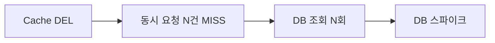
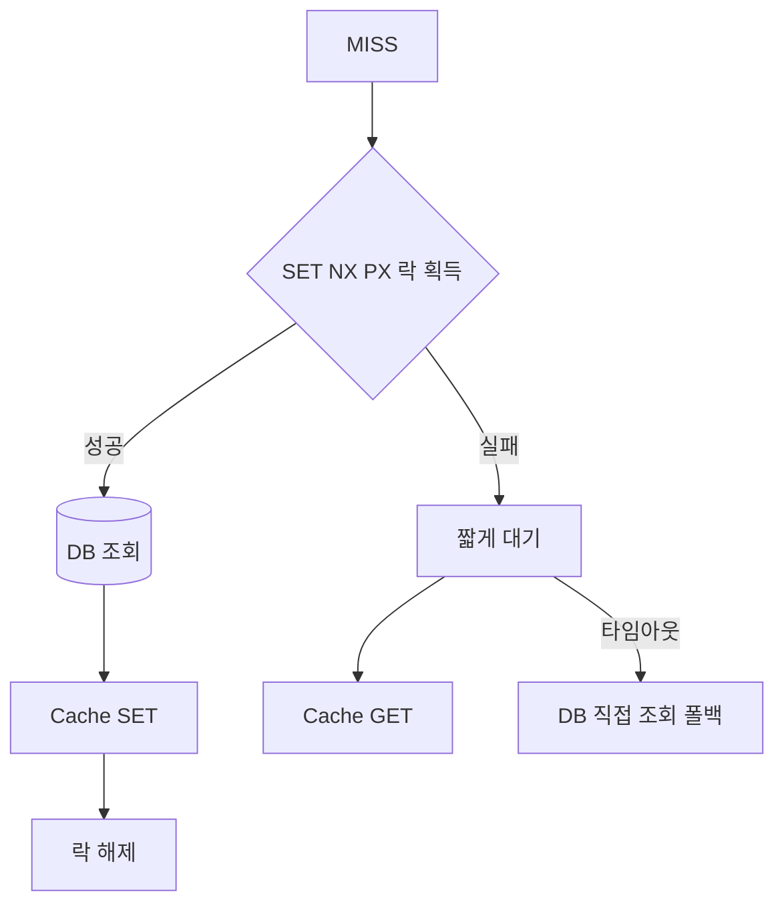
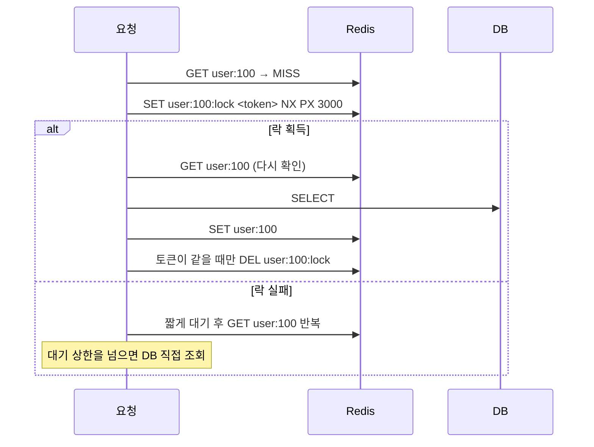
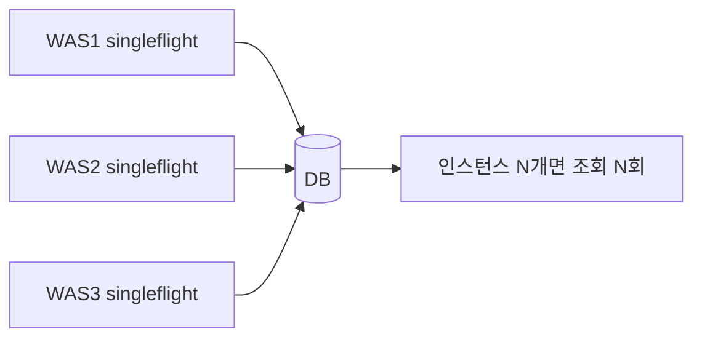
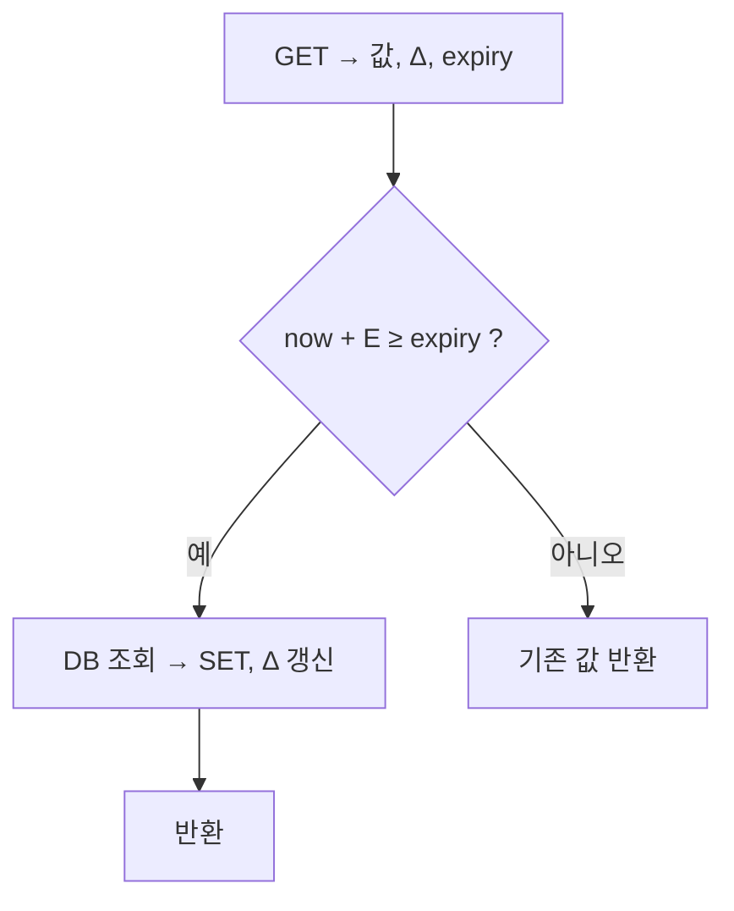
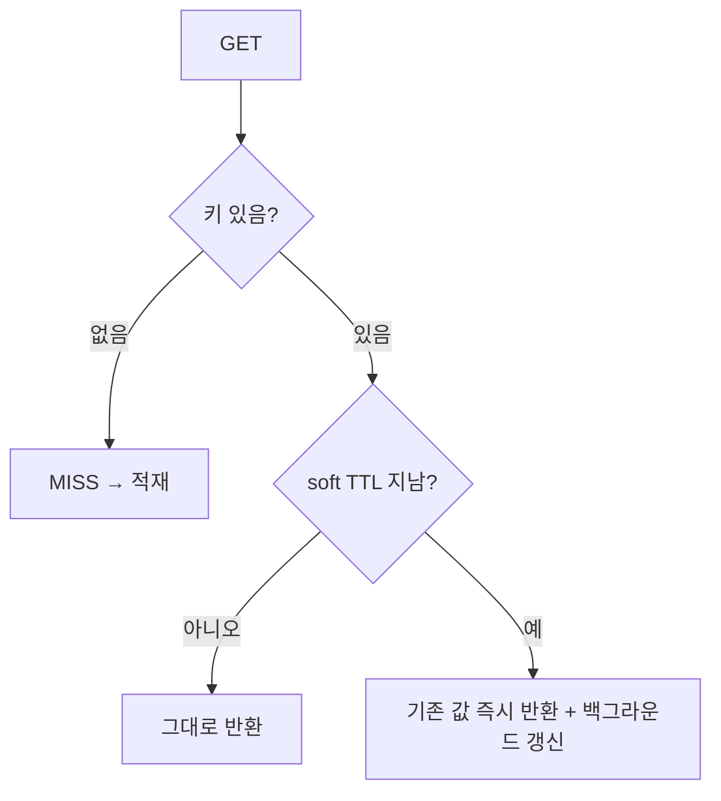
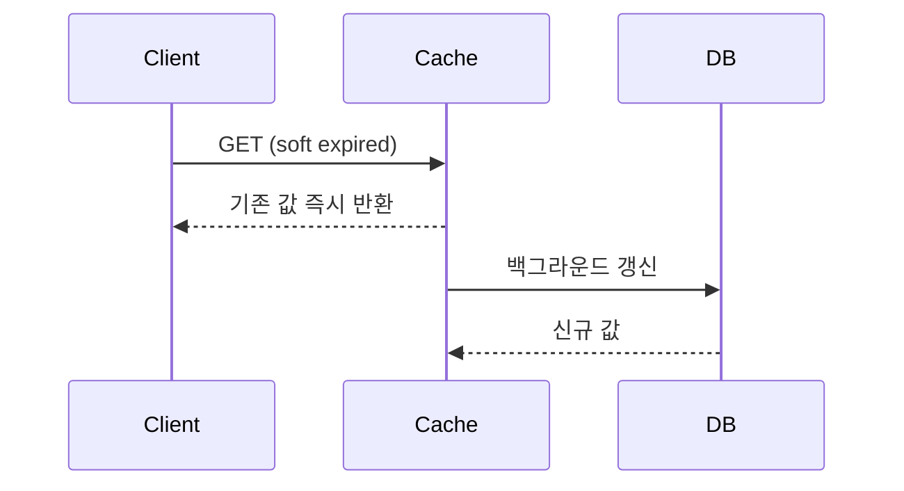
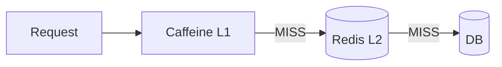
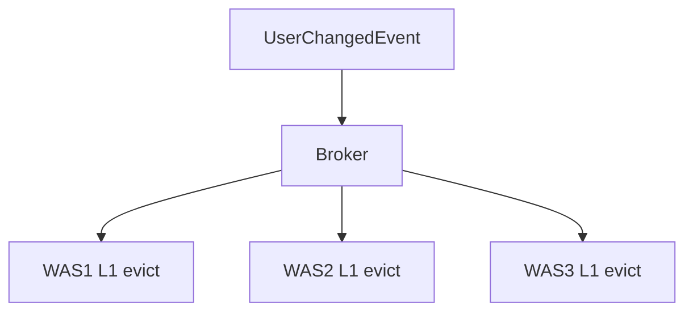

# Cache Stampede

무효화를 정확히 하는 것만큼 중요한 것이 **삭제 직후 누가 DB를 다시 채우는가**이다.

> Stampede는 캐시 장애 유형 중 하나다. Penetration·Avalanche·장애 전파는
> [cache-failure-modes.md](cache-failure-modes.md)에서 함께 비교한다.



무효화를 잘 할수록 이 문제는 오히려 더 자주 발생한다.
Redis 공식 cache-aside 가이드도 인기 키 만료 시의 stampede를 주요 문제로 지적한다.

## 대응 비교

| 기법 | 요청 간 조율(락) | 락 때문에 추가되는 Redis 쓰기 | 락을 잡은 요청이 죽으면 | 조회가 드문 키 | 무효화(DEL) 직후 |
|-----|--------------|-------------------------|-------------------|-------------|---------------|
| Single-Flight (분산 락) | 필요 | 락 획득·해제 2회 | **락 TTL 이 끝날 때까지 다른 요청이 대기 (TTL 이 없으면 무기한)** | 동작 | 동작 |
| Probabilistic Early Expiration (XFetch) | 불필요 | 없음 | 해당 없음 | 만료 직전에 조회가 없으면 그대로 만료 | **효과 없음** |
| Stale-While-Revalidate | 갱신에만 필요 | 갱신 락만큼 | 갱신 락 TTL 동안 갱신이 멈춤 | stale 구간에 조회가 없으면 갱신되지 않음 | **효과 없음** |

SWR 은 옛 값을 내주는 구간(stale 구간)에 후속 조회가 와야 갱신이 시작된다. 조회가 드문 키는 그 구간을 그냥 지나친다.

XFetch 와 SWR 은 TTL 만료에 대비하는 방법이다. 둘 다 아직 남아 있는 값을 이용하므로, 무효화로 키를 지우면 재사용할 값이 없다.
무효화 직후의 동시 MISS 를 직접 줄일 수 있는 것은 single-flight 다.
무효화를 삭제 대신 "논리 만료 표시" 로 바꾸면 SWR 을 적용할 수 있지만, 그 대가로 갱신이 끝날 때까지 옛 값이 의도적으로 보인다.

---

## Single-Flight (분산 락)

MISS 시 한 요청만 DB를 조회하도록 제한한다.



```text
SET cache:lock:user:100 <token> NX PX 3000
```

해제는 토큰 소유자만 가능해야 한다. Redis 8.4+는 `DELEX key IFEQ <token>`,
그 이전은 Lua 스크립트로 `GET` 후 일치 시 `DEL` 한다.

| 항목 | 결정 근거 |
|-----|---------|
| Lock TTL | DB 조회 + 캐시 적재 최대 소요 시간보다 길게 |
| 대기 시간 | Lock TTL보다 짧게, 초과 시 DB 직접 조회로 폴백 |
| 토큰 | 자신이 획득한 락만 해제하기 위한 소유권 식별자 |

### 알려진 비용

VLDB 2015 논문이 락 방식의 비용을 명시한다.

| 비용 | 내용 |
|-----|-----|
| 쓰기 2배 | 락 획득·해제가 추가 쓰기 연산 |
| TTL 튜닝 | 락 TTL을 재계산 시간에 맞춰야 한다 |
| 반환값 없음 | 락을 못 잡은 요청은 돌려줄 값이 없다 |
| **fault-tolerant 아님** | 락 보유자가 재계산 중 실패하면 **락 만료까지 무방비** |

### Redlock까지 필요한가

**아니다.** stampede 방지 락의 실패 비용은 안전성 위반이 아니라 DB 조회 1회다.
Redis 공식 문서도 "가끔의 경쟁 조건이 허용되는 경우"에는 단일 인스턴스 방식이 적합하다고 하며,
공식 cache-aside 가이드 자체가 단일 인스턴스 `SET NX PX`를 채택한다.

> 단, `SET` 명령 문서는 단일 인스턴스 락 패턴을 "Redlock을 권장한다"며 지양하라고 적는다.
> 두 공식 문서의 톤이 일치하지 않으므로 인용 시 출처를 구분한다.

### Spring 기본 대응이 실제로 하는 일

`@Cacheable(sync = true)` 는 동기화된 값 생성을 캐시 구현체에 요청할 뿐, 스스로 락을 걸지 않는다.
Spring 은 `Cache#get(key, loader)` 를 부르고, Redis 에서 실제로 막는 것은 `RedisCacheWriter` 의 락이다.

| 조합 | 동시 MISS N건 |
|-----|-------------|
| 락 없는 writer (`nonLockingRedisCacheWriter`) | `sync` 여부와 무관하게 N 번 적재 |
| 락 writer + `sync` 없음 | N 번 적재. 락은 `get(key, loader)` 안에서만 걸리고, `sync` 가 없으면 `get` 후 `put` 으로 호출되어 그 경로를 타지 않는다 |
| 락 writer + `sync = true` | 1 번 적재 |

락 writer 의 락은 `<캐시 이름>~lock` 하나다. 키 단위가 아니라서 다른 키의 적재도 대기하고,
key-prefix 가 붙지 않아 같은 Redis 를 쓰는 다른 애플리케이션과 락을 공유한다.
기본 락에는 만료가 없으므로 만료를 직접 걸어야 한다.
→ [`stampede-guard`](../../stampede-guard/README.md) 모듈이 테스트로 고정한다

### 락 writer 의 한계와 대책

| 한계 | 대책 |
|-----|-----|
| 락이 캐시 이름 단위라 다른 키도 대기한다 | 키 단위 분산 락을 직접 건다 (아래 구현 포인트) |
| 락 키에 key-prefix 가 없어 다른 애플리케이션과 락을 공유한다 | 캐시 이름에 애플리케이션 식별자를 넣거나, 키 단위 락에서 식별자를 직접 붙인다 |
| 기본 락에 만료가 없다 | `lockingRedisCacheWriter(factory, sleepTime, lockTtlFunction, batchStrategy)` 로 만료를 건다. DB 조회와 캐시 적재에 걸리는 시간을 측정해 그보다 길게 잡는다 |
| 기다리는 쪽에 시간 제한이 없다 | 키 단위 락에서 대기 상한을 두고, 넘으면 락 없이 DB 를 직접 읽는다. 이 폴백은 중복 조회를 일부 허용하는 대신 대기를 끊는다 |
| 기다리는 것 자체가 지연이다 | XFetch(만료 전에 미리 갱신)와 SWR(옛 값을 바로 반환)은 TTL 만료 때 요청을 줄 세우지 않는다. 단 TTL 만료에만 쓸 수 있다 |

### 키 단위 락 구현 포인트



| 항목 | 이유 |
|-----|-----|
| 락 키에 원본 캐시 키와 애플리케이션 식별자를 넣는다 | 키마다 따로 대기하고, 다른 애플리케이션과 섞이지 않는다 |
| 락을 잡은 뒤 다시 GET 한다 | 앞서 락을 잡았던 요청이 방금 채웠을 수 있다 |
| 토큰 일치 시에만 해제한다 | 만료 후 다른 요청이 잡은 락을 지우지 않는다 (Lua 또는 Redis 8.4+ `DELEX`) |
| 대기 상한과 DB 폴백을 둔다 | 락을 잡은 요청이 죽어도 나머지 요청이 락 TTL 전체를 기다리지 않는다 |

Spring Cache 추상화는 이 흐름을 직접 제공하지 않는다. 필요하면 `Cache` 구현을 감싸
`get(key, loader)` 에서 위 흐름을 수행하도록 만든다.

### 프로세스 로컬 single-flight의 한계

`golang.org/x/sync/singleflight` 같은 프로세스 내 중복 억제는 **인스턴스마다 독립**이다.



Discord는 키 기반 consistent hash 라우팅으로 같은 키를 한 인스턴스에 모아 적중률을 높였다.
그리고 이것이 **완전한 해결책이 아니라 완화책**이었다고 명시한다.

---

## Probabilistic Early Expiration (XFetch)

XFetch 는 TTL 이 실제로 끝날 때까지 기다리지 않는다. 만료 전에 일부 조회 요청이 캐시를 미리 갱신한다.
만료 전에 미리 갱신이 일어나면 키가 비는 구간을 피할 수 있어 동시 MISS 가 줄어든다.

**직관적으로.** 조회할 때마다 무작위로 "앞당김 시간" `E` 를 뽑는다.
현재 시각에 `E` 를 더한 값이 만료 시각을 넘으면, 즉 만료까지 남은 시간이 `E` 보다 짧으면 그 요청이 미리 갱신한다.

```text
E = Δ · β · (-log(rand()))
갱신 조건:  now + E ≥ expiry
```

논문은 같은 식을 `now - Δ · β · log(rand()) ≥ expiry` 로 쓴다. `log(rand())` 가 0 이하라서 빼는 것이 곧 더하는 것이다.

| 기호 | 의미 |
|-----|-----|
| `now` | 현재 시각 |
| `Δ` | 마지막 재계산(DB 조회 + 적재)에 걸린 시간. 값과 함께 저장한다 |
| `β` | 얼마나 일찍 갱신할지. 1 이 기본이고 클수록 일찍 갱신한다 |
| `rand()` | (0, 1] 균등 난수. 대부분 작은 `E` 가 나오고, 가끔 큰 `E` 가 나온다 |
| `log` | 자연로그(ln) |
| `expiry` | 키가 만료되는 시각 |

만료가 멀 때는 `E` 가 남은 시간을 넘는 일이 드물어 대부분 기존 값을 받는다.
만료가 가까워질수록 남은 시간이 줄어 일부 요청만 미리 갱신한다.
`Δ` 가 큰 값, 즉 재계산이 느린 값일수록 더 일찍 갱신될 가능성이 커진다.
재계산이 느린 값은 만료 직후 여러 요청이 동시에 DB 를 읽었을 때 피해가 크기 때문이다.



| 구현 포인트 | 내용 |
|-----------|-----|
| 저장 형식 | 값과 함께 `Δ`, `expiry` 를 저장한다. `PTTL` 로 만료를 구하면 왕복이 하나 늘어난다 |
| 락 없음 | 드물게 여러 요청이 동시에 미리 갱신한다. 같은 값을 다시 읽고 쓰는 비용만 든다 |
| Spring | Spring Cache 추상화에 없다. `Cache` 를 감싸 조회 경로에서 판단해야 한다 |

| 한계 | 내용 |
|-----|-----|
| 무효화(DEL) | 지워진 키에는 앞당길 만료가 없다. TTL 만료만 대비한다 |
| 조회 없는 키 | 만료 직전에 조회가 없으면 미리 갱신되지 않고 그대로 만료된다. 평소 조회가 드문 키에 갑자기 요청이 몰리면 single-flight 가 필요하다 |

---

## Stale-While-Revalidate

만료 이후에도 짧은 기간 기존 값을 제공하면서 백그라운드로 갱신한다.
이를 위해 갱신이 필요해지는 시점인 soft TTL 과, Redis 에서 키가 실제로 사라지는 hard TTL 을 따로 둔다.

| 만료 | 위치 | 의미 |
|-----|-----|-----|
| soft TTL | 값 안에 저장한 논리 만료 시각 | 지나면 "갱신이 필요한 값". 그래도 반환한다 |
| hard TTL | Redis 키 TTL (soft 보다 길게) | 지나면 키가 사라져 MISS |



백그라운드 갱신이 한 요청만 일어나도록 하려면 갱신 작업에 별도의 single-flight 가 필요하다(아래 구현 포인트).



| 장점 | 단점 |
|-----|-----|
| MISS 급증을 막는다 | **의도적으로 옛 값을 제공한다** |
| soft TTL 이후에도 바로 응답해 지연이 급증하지 않는다 | 구현이 복잡해진다 |

| 적합 | 부적합 |
|-----|-------|
| 상품 목록, 추천, 랭킹, 홈 화면, 통계 | 권한, 결제 상태, 보안 정책 |

> **저트래픽 키에서는 효과가 없다.**
> stale 구간 안에 후속 조회가 오지 않으면 백그라운드 갱신이 시작되지 않는다.
> 이 구현에서는 hard TTL 까지 지나면 다음 요청이 일반 MISS 경로를 탄다.
> stale 구간에 후속 요청이 있어야 비동기 재검증이 시작된다는 특성은 RFC 5861 §3.1 에서도 설명한다.

| 구현 포인트 | 내용 |
|-----------|-----|
| 갱신도 single-flight | soft TTL 이 지난 순간 몰린 요청이 모두 갱신하면 갱신 stampede 가 된다. 갱신만 락으로 하나로 줄인다 |
| 옛 값이 보이는 구간 | soft TTL 이 지난 뒤 갱신이 끝날 때까지다. 갱신이 시작되지 않으면 hard TTL 까지 이어진다 |
| 무효화와의 관계 | 키를 지우면 돌려줄 옛 값이 없다. DEL 대신 soft TTL 을 현재 시각으로 바꾸는 논리 무효화가 필요하고, 이 경우 갱신이 끝날 때까지 기존 값이 반환된다 |
| 로컬 캐시 | Caffeine 의 `refreshAfterWrite` 도 조회 시 기존 값을 돌려주면서 비동기로 다시 읽는, 비슷한 방식을 제공한다 |

---

## L1(Local) + L2(Redis)

Redis 조회도 network round-trip 비용이 되는 규모에서 쓴다.



`DB UPDATE → Redis DEL` 만으로는 부족하다. 각 WAS의 로컬 캐시가 그대로 남는다.



| 판단 기준 | 내용 |
|---------|-----|
| L1 TTL은 짧게 | 전파 실패 시 stale 상한을 낮춘다 |
| L1 대상은 선별적으로 | 변경이 드물고 조회가 압도적인 데이터만 |
| 전파 채널 신뢰성 | Pub/Sub 유실 가능성을 짧은 TTL로 보완 |

> **클러스터에서 keyspace notification은 전 노드로 브로드캐스트되지 않는다.**
> 클라이언트가 각 노드에 개별 구독해야 한다. 이를 모르면 무효화가 조용히 누락된다.

Redis client-side caching(RESP3 tracking)을 쓰더라도 공식 권고는 동일하다 —
**"TTL이 없는 키에도 max TTL을 걸어라."**

## Reference

- [Redis - Cache-aside](https://redis.io/docs/latest/develop/use-cases/cache-aside/)
- [Redis - Distributed locks](https://redis.io/docs/latest/develop/clients/patterns/distributed-locks/)
- [Redis - Client-side caching](https://redis.io/docs/latest/develop/clients/client-side-caching/)
- [Vattani et al., Optimal Probabilistic Cache Stampede Prevention, VLDB 2015](http://www.vldb.org/pvldb/vol8/p886-vattani.pdf)
- [RFC 5861 - stale-while-revalidate](https://www.rfc-editor.org/rfc/rfc5861.html)
- [Caffeine - Refresh](https://github.com/ben-manes/caffeine/wiki/Refresh)
- [Discord - How Discord Stores Trillions of Messages](https://discord.com/blog/how-discord-stores-trillions-of-messages)
