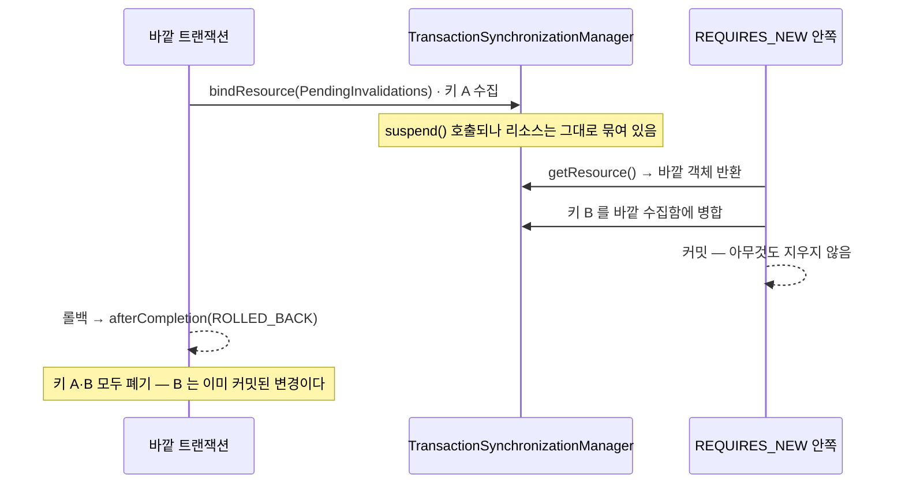

# 코어 전수조사

`cache-invalidation-core` 전체(main 20파일, 약 1,030줄)를 읽고 각 확장점의 **실제 소비처**를 집계한 결과다.

판정 기준은 하나다 — **선언한 대로 동작하는가.**
동작하지 않는 설정은 과도한 추상화보다 먼저 다룬다. 그것은 취향이 아니라 결함이다.

## 이 문서의 출처

**독립적으로 수행된 두 검토를 통합한 것**이다. 두 검토는 서로를 보지 않고 진행됐고,
R1(`KEYS` 실행)·R2(도달 불가 설정)·설정 기본값 결함·`EntityChange.State` 미사용·소유권 검증의 허약함을
**양쪽이 각각 독립적으로** 짚었다. 교차 확인된 항목은 신뢰도가 높다.

서로 놓친 것과 판정이 갈린 것은 [§6 두 검토의 차이](#6-두-검토의-차이)에 그대로 남겼다.
**결론이 어떻게 바뀌었는지가 결론 자체만큼 중요하다.**

| 항목 | 값 |
|---|---|
| 작성일 | 2026-10-18 |
| 기준 | `e37fc11f` + 미커밋 워킹트리 |
| 대조한 원본 | `spring-boot-autoconfigure` 3.5.0, `spring-data-redis` 3.5.0, `spring-tx` 6.2.7, `spring-context-support` 6.2.7, `hibernate-core` 6.6.15.Final (모두 소스 jar 직접 확인) |

> **줄 번호를 쓰지 않는다.** 조사 중에도 워킹트리가 바뀌어(`redisCacheWriter` 가 96행 → 99행)
> 줄 번호를 인용한 초판이 곧바로 틀렸다. 위치는 **클래스명과 메서드명**으로만 가리킨다.

---

## 요약

### P0 — 운영 결격

| ID | 내용 | 발현 조건 |
|----|-----|---------|
| [P0-1](#p0-1-pendinginvalidations-가-suspendresume-을-구현하지-않는다) | `REQUIRES_NEW` 에서 커밋된 변경의 무효화가 사라진다 | `REQUIRES_NEW` 사용 + 바깥 롤백 |
| [P0-2](#p0-2-clear-가-scan-이-아니라-keys-로-실행된다) | `clear()` 가 `SCAN` 이 아니라 블로킹 `KEYS` 로 실행된다 | **항상** |
| [P0-3](#p0-3-지터가-0-이하-ttl-을-만들면-영구-키가-된다) | 지터가 TTL 을 0 이하로 만들면 **영구 키**가 된다 | TTL 1초 또는 `jitter-ratio >= 1` |

### P1 — 정리 (운영 피해는 없으나 오해를 만든다)

| ID | 내용 |
|----|-----|
| [P1-1](#p1-1-unregistered-cachedefaults-는-도달하지-않는다) | `unregistered` cacheDefaults 도달 불가 — 죽은 코드 |
| [P1-2](#p1-2-springcachecache-names-는-정책-검사를-통과하지-않는다) | `spring.cache.cache-names` 가 정책 검사를 우회한다 |
| [P1-3](#p1-3-하이버네이트-내부-클래스에-의존한다) | Hibernate 내부 클래스 `SessionFactoryImpl` 의존 |
| [P1-4](#p1-4-javadoc-링크-2곳이-깨졌다) | Javadoc 링크 2곳 파손 |
| [P1-5](#4-문서-정합성) | `core-design.md` 에 사실과 다른 3줄 |

### P2 — 투입 전

| ID | 내용 |
|----|-----|
| [P2-1](#p2-1-무효화-실패가-어디에도-드러나지-않는다) | 무효화 실패가 로그 외에 드러나지 않는다 (메트릭 0) |
| [P2-2](#p2-2-0-과-미설정을-구분하지-못한다) | `jitter-ratio: 0` 으로 지터를 끌 수 없다 |

### P3 — 선택 / 보류

| ID | 내용 | 조치 |
|----|-----|-----|
| [O1](#o1-캐시-이름-문자열이-두-곳에-있다-4곳-복제) | 캐시 이름 문자열이 두 곳 (4곳 복제) | 선택 |
| [O2](#o2-설정을-켜는-방법이-두-가지다) | 상속과 `@Import` 혼재 | **보류** |
| [O3](#o3-확장점이-몇-번-호출되는지-계약에-없다) | 확장점 호출 횟수가 계약에 없다 | 권고 |
| [O4](#o4-entitychangestate-는-제품-소비자가-없다) | `EntityChange.State` 제품 소비자 0 | 유지(의도) |
| [O5](#o5-fallbackcacheerrorhandler-는-로그-4줄에-87줄이다) | `FallbackCacheErrorHandler` 87줄 / 로그 4줄 | 선택 |
| [O6](#o6-소유권-검증의-보장이-이름뿐이다) | 소유권 검증의 보장이 이름뿐 | 강화 또는 제거 |
| [O7](#o7-config-패키지에-런타임-리스너가-산다) | `config` 에 런타임 리스너 | 기록만 |

**운영 투입 판정 — 현재 상태로는 부적합.**
설계 방향은 운영 수준이다. 문제는 **P0 세 건이 테스트를 통과하면서 운영에서만 터진다**는 데 있다.

---

# 1. 운영 결격 (P0)

## P0-1. `PendingInvalidations` 가 `suspend()`/`resume()` 을 구현하지 않는다

가장 심각하다. **커밋된 변경의 무효화가 조용히 사라진다.**

`PendingInvalidations` 는 `bindResource(RESOURCE_KEY, this)` 로 자신을 스레드에 묶는다.
그런데 스프링의 트랜잭션 중단(suspend)은 **그 리소스를 떼 주지 않는다.** 동기화 객체가 직접 떼야 한다.

```java
// spring-tx 6.2.7 — TransactionSynchronization
/**
 * Suspend this synchronization.
 * Supposed to unbind resources from TransactionSynchronizationManager if managing any.
 */
default void suspend() { }      // ← 기본 구현은 아무것도 하지 않는다

// spring-tx 6.2.7 — AbstractPlatformTransactionManager#doSuspendSynchronization
for (TransactionSynchronization synchronization : suspendedSynchronizations) {
    synchronization.suspend();                        // ← 각자 알아서 떼라
}
TransactionSynchronizationManager.clearSynchronization();
```

프레임워크의 표준 구현은 정확히 그렇게 한다.

```java
// spring-tx 6.2.7 — ResourceHolderSynchronization
public void suspend() {
    if (this.holderActive) { TransactionSynchronizationManager.unbindResource(this.resourceKey); }
}
public void resume() {
    if (this.holderActive) { TransactionSynchronizationManager.bindResource(this.resourceKey, this.resourceHolder); }
}
```

`PendingInvalidations` 에는 이 두 메서드가 없다. 결과는 다음과 같다.



| | 결과 |
|---|---|
| 안쪽이 커밋돼도 | 그 시점에 **지우지 않는다** (바깥 수집함에 들어갔으므로) |
| 바깥이 롤백되면 | **이미 커밋된 안쪽 변경의 키까지 버린다** |
| 남는 것 | TTL 이 끝날 때까지 옛 값. 로그조차 남지 않는다 |
| 검증 | **테스트 0건** |

`boundTo()` 가 `pending != null` 이면 `registerSynchronization` 을 건너뛰므로
안쪽 트랜잭션에는 동기화가 아예 등록되지 않는다는 점도 같은 원인이다.

**고치는 법** — `ResourceHolderSynchronization` 과 같은 방식.

```java
@Override
public void suspend() {
    TransactionSynchronizationManager.unbindResourceIfPossible(RESOURCE_KEY);
}

@Override
public void resume() {
    TransactionSynchronizationManager.bindResource(RESOURCE_KEY, this);
}
```

**검증 명제** — `PendingInvalidationsTest` 로 고정했다.

| 명제 | 수정 전 |
|-----|:---:|
| 안쪽이 커밋되는 시점에 안쪽 키를 지운다 | **RED** |
| 바깥이 롤백해도 안쪽에서 커밋된 키는 지워진다 | **RED** |
| 바깥이 커밋되면 바깥 키는 그때 지운다 | **RED** |
| 수집함을 스레드에서 떼어 다음 트랜잭션에 새지 않게 한다 | green |

> 회귀 테스트를 쓸 때 **바깥이 수집하기 전에** 안쪽을 호출하면 결함 경로를 타지 않는다.
> 중단 시점에 묶인 리소스가 없으면 안쪽이 자기 수집함을 만들기 때문이다.
> 바깥이 먼저 수집해야 재현된다.

**조치 완료** — `ResourceHolderSynchronization` 과 같은 방식으로 구현했다.

## P0-2. `clear()` 가 `SCAN` 이 아니라 `KEYS` 로 실행된다

코드는 SCAN 을 쓰겠다고 선언하지만, 실행되는 것은 블로킹 `KEYS` 다.

```java
// AbstractRedisCacheConfig#redisCacheWriter
@Bean
protected RedisCacheWriter redisCacheWriter(...) {
    return RedisCacheWriter.nonLockingRedisCacheWriter(connectionFactory,
         BatchStrategies.scan(properties.invalidation().clearScanBatchSize()));
}
```

Boot 가 `CacheManager` 를 만드는 자리에 **`RedisCacheWriter` 빈 조회가 없다.**

```mermaid
flowchart TD
    subgraph 우리가_선언한_것
        A["@Bean redisCacheWriter<br/>BatchStrategies.scan(n)"]
        A2["소비하는 코드 없음"]
        A --> A2
    end

    subgraph 실제로_실행되는_것
        B["RedisCacheConfiguration#cacheManager"]
        C["RedisCacheManager.builder(redisConnectionFactory)"]
        D["RedisCacheManagerBuilder.fromConnectionFactory"]
        E["nonLockingRedisCacheWriter(cf, BatchStrategies.keys())"]
        F["Keys#cleanCache → connection.keys(pattern)"]
        B --> C --> D --> E --> F
    end

    classDef dead stroke-dasharray: 5 5
    class A,A2 dead
```



```java
// spring-boot-autoconfigure 3.5.0 — RedisCacheConfiguration#cacheManager
RedisCacheManagerBuilder builder = RedisCacheManager.builder(redisConnectionFactory)

// spring-data-redis 3.5.0 — RedisCacheManagerBuilder#fromConnectionFactory
RedisCacheWriter cacheWriter = RedisCacheWriter.nonLockingRedisCacheWriter(connectionFactory);
//  → nonLockingRedisCacheWriter(cf, BatchStrategies.keys())

// spring-data-redis 3.5.0 — BatchStrategies.Keys#cleanCache
byte[][] keys = connection.keys(pattern)   // O(N) 블로킹
```

| 결과 | |
|---|---|
| `@Bean redisCacheWriter` | 컨텍스트에 존재하나 **주입처 0** |
| `service.cache.invalidation.clear-scan-batch-size` | **무효** |
| `ServiceCacheProperties.Invalidation` 레코드 | **무효** |
| 검증 | **테스트 0건** |

**고치는 법** — `RedisCacheManagerBuilder.cacheWriter(RedisCacheWriter)` 가 존재하므로 한 줄이다.

```java
return builder -> builder
     .cacheWriter(RedisCacheWriter.nonLockingRedisCacheWriter(
          connectionFactory,
          BatchStrategies.scan(properties.invalidation().clearScanBatchSize())
     ))
     .disableCreateOnMissingCache()
     .withInitialCacheConfigurations(byCacheName);
```

`@Bean redisCacheWriter` 는 **삭제**한다 — 빈일 이유가 없다.

**`enable-statistics` 는 유지된다.** `build()` 가 writer 설정 이후에 수집기를 붙이기 때문이다.

```java
// spring-data-redis 3.5.0 — RedisCacheManagerBuilder#build
RedisCacheWriter resolvedCacheWriter = !CacheStatisticsCollector.none().equals(this.statisticsCollector)
        ? this.cacheWriter.withStatisticsCollector(this.statisticsCollector)
        : this.cacheWriter;
```

**검증 명제** — `clear()` 가 `KEYS` 를 실행하지 않는다.

## P0-3. 지터가 0 이하 TTL 을 만들면 영구 키가 된다

Spring Data Redis 는 **0 이하 TTL 을 "만료 없음"으로 해석한다.**

```java
// spring-data-redis 3.5.0 — DefaultRedisCacheWriter
private static boolean shouldExpireWithin(@Nullable Duration ttl) {
    return ttl != null && !ttl.isZero() && !ttl.isNegative();
}

private void doPut(..., @Nullable Duration ttl) {
    if (shouldExpireWithin(ttl)) {
        connection.stringCommands().set(key, value, Expiration.from(...), SetOption.upsert());
    } else {
        connection.stringCommands().set(key, value);   // ← 만료 없음. 영구 키
    }
}
```

`JitteredTtlResolver` 에는 결과값 하한이 없다.

```java
private Duration jittered(Duration baseTtl) {
    return baseTtl.plusSeconds(offsetGenerator.applyAsLong(boundOf(baseTtl)));   // offset ∈ [-bound, +bound]
}

private long boundOf(Duration baseTtl) {
    long jitterSeconds = (long)(baseTtl.toSeconds() * jitterRatio);
    return Math.max(MINIMUM_JITTER_SECONDS, jitterSeconds);                      // 하한 1초
}
```

`bound >= baseTtl` 이면 결과가 0 이하가 될 수 있다.

| 조건 | bound | 결과 TTL 범위 | 영구 키 |
|-----|:---:|---|:---:|
| `ttl=1s`, `ratio=0.1` | `max(1, 0) = 1` | `{0, 1, 2}` | **1/3 확률** |
| `ttl=10s`, `ratio=1.0` | `max(1, 10) = 10` | `[0, 20]` | **가능** |
| `ttl=10s`, `ratio=1.5` | `max(1, 15) = 15` | `[-5, 25]` | **가능** |
| `ttl=3s`, `ratio=0.1` (ttl-only 현행) | `max(1, 0) = 1` | `{2, 3, 4}` | 안전 |
| `not-found-ttl=30s`, `ratio=0.1` (현행) | `max(1, 3) = 3` | `[27, 33]` | 안전 |

**현재 설정으로는 발현하지 않는다.** 그러나 `CachePolicy.Spec` 은 `ttl > 0` 만 검증하므로 1초 정책이 합법이고,
`jitterRatio` 에는 상한 검증이 없다. **합법적인 설정값으로 도달할 수 있는 잠복 결함**이다.
기존 테스트는 `+bound` 쪽만 확인한다.

**고치는 법** — 결과에 하한을 두고, `jitterRatio` 에 상한 검증을 건다.

**검증 명제**
- `ttl=1s` 에서 어떤 난수가 나와도 0 이하 TTL 을 만들지 않는다
- `jitter-ratio >= 1` 은 기동 시점에 거부한다

---

# 2. 정리 (P1)

## P1-1. `unregistered` cacheDefaults 는 도달하지 않는다

```java
return builder -> builder
     .disableCreateOnMissingCache()
     .cacheDefaults(unregistered)          // ← 읽히지 않는다
     .withInitialCacheConfigurations(byCacheName);
```

| 경로 | 왜 도달하지 않나 |
|-----|---------------|
| `getMissingCache(name)` | `disableCreateOnMissingCache()` → `isAllowRuntimeCacheCreation() == false` → `getDefaultCacheConfiguration()` 을 **평가하지 않고** null 반환 |
| `resolveCacheConfiguration(config)` | `config != null ? config : getDefaultCacheConfiguration()` — `withInitialCacheConfigurations` 가 모든 캐시에 non-null 을 넣으므로 분기가 성립하지 않음 |

미등록 캐시명의 실제 보장은 `cacheDefaults` 가 아니라 `disableCreateOnMissingCache()` 가 만든다.
`getCache("X")` 가 null 을 반환하고 Spring 이 `Cannot find cache named 'X'` 로 실패시킨다.

> **등급 조정** — 초판은 이것을 "운영 결격" 으로 올렸으나 **과했다.**
> 도달하지 않는 코드는 운영에 피해를 주지 않는다. 오해를 만들 뿐이므로 **정리 대상**이다.

제거 대상: `cacheDefaults(unregistered)`, `UNREGISTERED_FALLBACK_TTL` 과 null 삼항,
`SerializerFactory.unregisteredCacheSerializer()`(구현자가 **호출되지 않을 메서드**를 구현해야 했다),
`JsonSerializerFactory.UnregisteredCacheSerializer`.

**검증 명제** — 등록하지 않은 캐시명은 `CacheManager` 가 돌려주지 않는다.

## P1-2. `spring.cache.cache-names` 는 정책 검사를 통과하지 않는다

`initialCacheNames` 는 호출 시점의 `defaultCacheConfiguration` 을 **그 자리에서 복사**한다.

```java
// spring-data-redis 3.5.0 — RedisCacheManagerBuilder#initialCacheNames
cacheNames.forEach(it -> withCacheConfiguration(it, defaultCacheConfiguration));
```

Boot 는 이것을 **커스터마이저보다 먼저** 호출한다.

```java
// spring-boot-autoconfigure 3.5.0 — RedisCacheConfiguration#cacheManager
if (!cacheNames.isEmpty()) { builder.initialCacheNames(new LinkedHashSet<>(cacheNames)); }   // ① 먼저
...
redisCacheManagerBuilderCustomizers.orderedStream().forEach(c -> c.customize(builder));      // ② 나중
```

따라서 `spring.cache.cache-names` 로 선언한 캐시 중 우리 정책에 없는 이름은
**Boot 기본 설정(JDK 직렬화, 정책 없음)으로 생성되고, `disableCreateOnMissingCache` 에도 걸리지 않는다.**

현재 어떤 yml 에도 `cache-names` 가 없어 발현하지 않는다. 설정 한 줄로 열리는 구멍이므로 기록한다.

## P1-3. 하이버네이트 내부 클래스에 의존한다

```java
// JpaEntityChangeConfig#registryOf
entityManagerFactory.unwrap(SessionFactoryImpl.class)   // org.hibernate.internal — 내부 구현
```

SPI 인 `org.hibernate.engine.spi.SessionFactoryImplementor` 가 `getServiceRegistry()` 를 제공하므로
그것으로 충분하다. 마이너 버전 업그레이드에 깨질 이유를 만들 필요가 없다.

## P1-4. Javadoc 링크 2곳이 깨졌다

| 위치 | 문제 |
|-----|-----|
| `AbstractRedisCacheConfig` | `{@link com.gmoon.cacheinvalidation.JpaEntityChangeConfig}` — 실제 패키지는 `...cacheinvalidation.config` |
| `PublishedEntityChangeConfig` | `{@link EntityChange#of(...)}` 를 쓰면서 `EntityChange` 를 import 하지 않음 |

---

# 3. 투입 전 (P2)

## P2-1. 무효화 실패가 어디에도 드러나지 않는다

예외를 삼키는 층이 넷인데 전부 `log.warn` 이다.

```
DefaultCacheInvalidator.invalidate()        try/catch → warn
  └ resolveInIsolation()                    try/catch → warn
  └ evict()                                 try/catch → warn
FallbackCacheErrorHandler (@Cacheable 경로)  4개 메서드 → warn
```

| 확인 | 결과 |
|-----|-----|
| `micrometer` · `actuator` 의존성 | 없음 |
| `MeterRegistry` 참조 | 0건 |
| `enable-statistics: true` | 켜 두었으나 **읽는 쪽 없음** |

> 무효화 실패는 해당 TTL 이 만료될 때까지 stale 응답을 준다.
> 그런데 TTL 이 알아서 덮어 주므로 **조용히 썩고, 로그 집계 없이는 영원히 모른다.**

제거한 `InvalidationRecorder` 는 아무것도 하지 않는 껍데기였으므로 제거가 맞다.
올바른 답은 자체 기록기가 아니라 Micrometer 다.

**다만 코어가 actuator 를 강제해서는 안 된다.**
`micrometer-core` 를 선택 의존(`compileOnly` / `optional`)으로 두고
`ObjectProvider<MeterRegistry>` 로 받아 **없으면 계측하지 않는** 형태가 맞다.

측정 항목은 [concepts/metrics.md](concepts/metrics.md) 참조.

## P2-2. `0` 과 미설정을 구분하지 못한다

```java
// ServiceCacheProperties
jitterRatio = jitterRatio <= 0 ? DEFAULT_JITTER_RATIO : jitterRatio;        // 0 → 0.1
clearScanBatchSize = clearScanBatchSize <= 0 ? DEFAULT : clearScanBatchSize;
```

`0`(끄기)과 미설정을 구분하지 못한다. 장애 조사 중 "지터를 빼고 재현" 이 불가능하고,
설정을 잘못 넣어도 조용히 묻힌다.

기본값은 바인딩 시점(`@DefaultValue`)에, 검증은 `@Validated` 로 기동 시점에 실패시킨다.

> **중첩 record 의 함정** — `expiration` 블록 자체가 yml 에 없으면 중첩 record 가 `null` 로 바인딩된다.
> 따라서 **바깥 파라미터(`Expiration expiration`)에도 `@DefaultValue` 를 붙여야** 한다.
> 안쪽 필드에만 붙이면 블록 누락 시 NPE 로 떨어진다.

---

# 4. 문서 정합성

[core-design.md](core-design.md) 의 "프레임워크가 주는 것을 다시 만들지 않는다" 표에 **사실과 다른 줄이 셋** 있다.

| 현재 기재 | 실제 | 사유 |
|---------|-----|-----|
| `clear()` 시 SCAN 사용 → `BatchStrategies.scan(n)` | **KEYS 로 동작** | P0-2 |
| 캐시 실패·무효화 결과 관측 → 쓰기 전용 포트 2종 | **존재하지 않음** | `e37fc11f` 에서 제거됨 |
| 미등록 캐시 차단 → 기본 도달 시 예외 던지는 직렬화기 | 차단은 되나 **직렬화기는 도달 불가** | P1-1 |

[concepts/serialization.md](concepts/serialization.md) 의 미등록 캐시 직렬화기 서술도 P1-1 과 함께 본다.

---

# 5. 필요한 것과 과도한 것

## 5.1 과하지 않은 것 — 유지

| 대상 | 근거 |
|-----|-----|
| `FallbackCacheErrorHandler` 의 존재 | Spring 기본(`SimpleCacheErrorHandler`)은 예외를 전파해 Redis 장애 = 서비스 장애 |
| `CachePolicy` + `Spec` | 캐시별 TTL · 타입별 직렬화 · 미등록 차단을 맡는다. Jackson 다형 타이핑을 피해 보안·호환성에도 유리 |
| `ObjectMapper` 의 모르는 필드 무시 | 롤링 배포 중 스키마가 섞여도 안전 |
| `disableCreateOnMissingCache()` | 미등록 캐시명을 차단. P1-1 의 실제 보장도 여기서 나온다 |
| `JpaEntityChangeListener` | 쓰기 코드에 캐시 코드가 남지 않는다. **이 모듈이 존재하는 핵심 이유** |
| `CacheKey` | |
| `DefaultCacheInvalidator` 의 규칙 순회와 규칙별 실패 격리 | |
| `PendingInvalidations` (P0-1 수정 전제) | 중복 DEL 을 **측정으로 확인하고** 만든 것. [§6.2](#62-판정이-갈렸다가-합의된-것) 참조 |
| `TtlResolver.jittered()` · `SerializerFactory.json()` 정적 팩토리 | `config` 가 구현 클래스를 **볼 수 없게** 만든 수단 |

## 5.2 과도한 것

### O1. 캐시 이름 문자열이 두 곳에 있다 (4곳 복제)

```java
public enum UserCachePolicy implements CachePolicy {
    USER(new Spec(Name.USER, Duration.ofMinutes(10), CachedUser.class));
    //              └ "USER" 첫 번째
    public static final class Name {
        public static final String USER = "USER";   // ← "USER" 두 번째
        private Name() {}
    }
}
```

캐시 1개당 12줄, 이름이 두 곳이라 **드리프트가 가능**하다.
`ttl-only/UserCachePolicy`, `write-invalidate/UserCachePolicy`, `ArticleCachePolicy`, `TestCachePolicy`
네 곳에 글자 그대로 복제돼 있다.

`cacheName()` 의 기본 구현을 `name()` 으로 내리면 문자열 하나와 `Spec` 필드 하나가 사라진다.
`Name` 홀더는 없앨 수 없다 — `@Cacheable(cacheNames = ...)` 가 컴파일 타임 상수를 요구하는
**자바 제약**이지 설계 실수가 아니다.

### O2. 설정을 켜는 방법이 두 가지다

`AbstractRedisCacheConfig` 의 Javadoc 이 스스로 한계를 적고 있다.

> 자바는 단일 상속이라 JPA 와 이벤트를 함께 쓰는 모듈을 상속만으로 표현할 수 없다.

절반(신호원)은 `@Import` 로 우회하고 절반(정책·규칙)은 상속으로 남았다.
추상 클래스 상속 + `@Import` 조합 + 재정의 가능한 `protected @Bean` 4개가 겹쳐
**어떤 빈이 실제로 쓰이는지 코드만 봐서는 알 수 없다.**
P0-2(빈은 있는데 아무도 안 씀)와 P1-1(쓰이지 않는 cacheDefaults)이 바로 그 증상이다.

일관되게 가려면 상속을 버리고 Boot auto-config 로 `CachePolicy`/`InvalidationRule` 빈을 모으는 쪽이다.
소비자 코드 전면 변경이고 지금도 동작하므로 **보류**한다.

### O3. 확장점이 몇 번 호출되는지 계약에 없다

```java
@PostConstruct void validateInvalidationOwnership() {
    List<InvalidationRule> rules = invalidationRules();              // 새 객체 세트 A
}
@Bean CacheInvalidator cacheInvalidator(CacheManager cacheManager) {
    return CacheInvalidator.of(invalidationRules(), cacheManager);   // 새 객체 세트 B
}
```

`invalidationRules()` 는 `@Bean` 이 아니므로 CGLIB 캐싱을 타지 않는다. 호출마다 새로 만들어진다.
`cachePolicies()` 도 같다 — 검증과 커스터마이저에서 각각.

지금은 규칙이 무상태라 무해하다. 문제는 **검증이 본 객체와 실행이 쓰는 객체가 다르다**는 것이다.
사용자가 규칙에 상태를 넣는 순간 조용히 어긋난다. 한 번 평가해 필드에 고정하면 끝난다.

### O4. `EntityChange.State` 는 제품 소비자가 없다

| | |
|---|---|
| `State` 를 **채우는** 곳 | `JpaEntityChangeListener` (제품) |
| `previousValueOf()` 를 **읽는** 곳 | 테스트뿐 |
| 비용 | 코어 30줄 + 테스트 90줄 + **모든 엔티티 수정마다 속성 배열 복사** |

`EvictableEntityRule` 은 이전 상태를 보지 않는다.
자연키가 바뀌는 캐시 키를 쓰게 되면 필요해지는 **알고 남긴 수용력**이다. 결함으로 분류하지 않되
런타임 비용(배열 복사)이 있다는 점은 기록한다.

### O5. `FallbackCacheErrorHandler` 는 로그 4줄에 87줄이다

인자 4개짜리 오버라이드 네 개에 개행 규칙을 적용한 결과다.
규칙은 유지하되 "중첩이 깊으면 먼저 펼친다" 조항으로 줄일 여지가 있다. 우선순위는 낮다.

### O6. 소유권 검증의 보장이 이름뿐이다

`InvalidationRule.verifyOwnership` 은 **선언만 대조한다.**
`resolve()` 가 실제로 `owns()` 안의 정책 키만 돌려주는지는 강제하지 않는다.
그러면서 아무것도 하지 않는 `TtlOnlyRule` 을 따로 선언하게 만든다.

또한 `supports()` 와 `resolve()` 가 같은 검사를 두 번 한다 —
`EvictableEntityRule` 은 두 메서드에서 똑같이 `instanceof CacheEvictable` 을 확인한다.
`resolve()` 가 빈 목록을 돌려주면 `supports()` 는 없어도 된다.

**보장을 강화하거나(resolve 결과를 owns 로 제한) 없애거나** 둘 중 하나다.
소유권은 규칙보다 `CachePolicy` 의 속성에 가깝다.

### O7. `config` 패키지에 런타임 리스너가 산다

`JpaEntityChangeListener` · `PublishedEntityChangeListener` 는 설정이 아니라 런타임 컴포넌트인데
**package-private 로 숨기려고** `config` 에 들어가 있다.
자바의 package-private 가 하위 패키지를 넘지 못하는 제약이 패키지 이름의 의미를 희석시켰다.
기능 문제는 없는 **의도된 교환**으로 기록한다.

## 5.3 읽기 쉬운가

클래스 개수는 문제가 아니다. 소비자 모듈이 이 코어를 쓰는 비용이 설정 8줄이라는 것이 그 증거다.

문제는 **흐름 하나를 따라가는 거리**다.
"User 수정 → `USER::id` 삭제" 를 따라가는 데 **12단계, 패키지 4개**를 오간다.

```
JpaEntityChangeConfig → Listener → EntityChange → CacheInvalidator → DefaultCacheInvalidator
  → InvalidationRule → EvictableEntityRule → CacheEvictable → CacheKey → CachePolicy.Spec
  → PendingInvalidations → evict
```

더 큰 문제는 [O2](#o2-설정을-켜는-방법이-두-가지다) — 어떤 빈이 실제로 쓰이는지 코드만으로 알 수 없다는 점이다.

## 5.4 운영에서 고려할 점 (결함은 아님)

- **커밋 후 삭제는 키마다 순차 왕복이고 커밋한 스레드에서 동기로 실행된다.**
  대량 배치 트랜잭션이면 키가 전부 메모리에 쌓였다가 커밋 후 `DEL` 을 N번 보낸다.
  파이프라이닝이나 `unlink` 묶음 전송을 고려할 수 있다.
- **Redis 장애 시 요청마다 timeout(1초)을 기다리고 WARN 스택트레이스를 남긴다.**
  서킷 브레이커가 없어 로그가 폭주한다. [P2-1](#p2-1-무효화-실패가-어디에도-드러나지-않는다) 과 함께 본다.
- **커밋 후 삭제로도 cache-aside 고유의 경합은 막지 못한다.**
  읽기가 옛 값을 읽는 사이 쓰기가 커밋·삭제하고, 읽기가 옛 값을 다시 저장하는 경우다. 상한은 TTL 뿐이다.
  README 의 Level 1 이 이를 허용하므로 **의도한 선택이라면 괜찮다.**

---

# 6. 두 검토의 차이

두 검토가 독립적으로 수행됐으므로, 어느 쪽이 무엇을 놓쳤고 판정이 어떻게 수렴했는지 남긴다.

## 6.1 양쪽이 독립적으로 일치한 것 — 신뢰도 높음

P0-2(`KEYS` 실행) · P1-1(도달 불가 cacheDefaults) · P2-2(설정 기본값이 0을 삼킴) ·
O4(`EntityChange.State` 미사용) · O6(소유권 검증의 허약함) · O2(상속과 `@Import` 혼재) ·
`FallbackCacheErrorHandler` 필요 · `disableCreateOnMissingCache` 적절.

## 6.2 판정이 갈렸다가 합의된 것

| 쟁점 | 검토 A | 검토 B | 합의 |
|-----|-------|-------|-----|
| `PendingInvalidations` | "유지 — 측정 근거" | "`transactionAware()` 로 대체" | **유지 + `suspend`/`resume` 구현** |
| 단일 구현 인터페이스 (`SerializerFactory`·`TtlResolver`) | "좋음 — 의존 방향 강제" | "과도 — private 메서드로 충분" | **수용 가능** |
| `unregistered` 등급 | "운영 결격" | "죽은 코드일 뿐" | **정리 대상(P1)** |
| 소유권 검증 | "유지하되 재고" | "보장이 이름뿐" | **강화 또는 제거** |

**`transactionAware()` 를 채택하지 않는 이유.**
`TransactionAwareCacheDecorator` 는 `evict` 를 `afterCommit` 으로 미뤄 주고 현재 동기화 목록에 붙으므로
`REQUIRES_NEW` 에서도 정확하다 — P0-1 이 함께 사라지는 것은 사실이다. 그러나

- **중복 제거를 잃는다.** 두 신호원을 함께 켜면 같은 키에 DEL 이 2회 나간다.
  이 중복은 추측이 아니라 **측정으로 확인된 것**이고, 그래서 `PendingInvalidations` 를 만들었다.
- **`put` 도 함께 지연된다.** evict 만 바꾸는 선택지가 없다. 읽기 경로의 캐시 적재 시점이 바뀐다.
- **`putIfAbsent` 와 `evictIfPresent` 는 지연되지 않는다.** 같은 캐시에서 동작이 비대칭이 된다.

`suspend`/`resume` 두 메서드를 구현하는 쪽이 범위가 좁고 측정 결과를 지킨다.

## 6.3 각 검토만 짚은 것

| 검토 A 만 짚음 | 검토 B 만 짚음 |
|--------------|--------------|
| P2-1 관측 수단 부재 (메트릭 0) | **P0-1 `suspend`/`resume` 누락** |
| O1 캐시 이름 문자열 중복 (4곳) | **P0-3 지터 TTL 하한 없음** |
| O3 확장점 호출 횟수가 계약에 없음 | P1-2 `cache-names` 가 정책 우회 |
| §4 문서 정합성 (거짓 3줄) | P1-3 Hibernate 내부 클래스 의존 |
| P0-2 의 정확한 수정 경로 (`cacheWriter()` 세터) | P1-4 Javadoc 링크 파손 |
| | O6 `supports()` 중복 검사 |
| | §5.3 12단계 사슬 · §5.4 운영 고려사항 |

> **놓친 쪽이 더 무거웠다.** 검토 A 는 P0 두 건(P0-1·P0-3)을 놓쳤고,
> 그중 P0-1 은 §5.1 에서 **"유지" 로 판정했던 바로 그 클래스**다.
> "내가 설계한 것" 을 감사 대상에서 무의식적으로 제외한 것이 원인이다.

---

# 7. 조치 순서

| 순서 | 항목 | 내용 | 회귀 테스트 |
|:--:|-----|-----|-----|
| ~~1~~ | ~~P0-1~~ | ~~`PendingInvalidations.suspend()`/`resume()` 구현~~ **완료** | `PendingInvalidationsTest` 8명제 |
| **2** | P0-2 | 커스터마이저에서 `cacheWriter(...)`, `@Bean redisCacheWriter` 삭제 | `clear()` 가 `KEYS` 를 쓰지 않음 |
| **3** | P0-3 | 지터 결과 하한 + `jitterRatio` 상한 검증 | `ttl=1s` 에서 0 이하 TTL 불가 |
| 4 | P1-1 | `unregistered` 일체 제거 | `getCache("X") == null` |
| 5 | P1-3 | `SessionFactoryImplementor` 로 전환 | 기존 통합 테스트로 충분 |
| 6 | P1-4 · P1-5 | Javadoc 링크, `core-design.md` 3줄, `serialization.md` | — |
| 7 | P2-1 | `ObjectProvider<MeterRegistry>` 로 무효화 실패 계측 | 레지스트리 부재 시 무계측 |
| 8 | P2-2 | `@DefaultValue`(바깥 파라미터 포함) + `@Validated` | 블록 누락 시 기본값, 잘못된 값은 기동 실패 |
| 9 | O3 | 확장점 1회 평가 후 고정 | — |
| 10 | O1 · O6 | 이름 중복 제거, 소유권 검증 강화 또는 제거 | — |
| 11 | O5 | `FallbackCacheErrorHandler` 축약 | — |
| — | O2 | 상속 제거 | **보류** |

2·4 는 같은 메서드(`cachePolicyCustomizer`)를 건드리므로 한 커밋으로 묶는다.
1~3 은 각각 독립된 결함이므로 커밋을 나눈다.

## 진행 로그

| 일시 | 항목 | 결과 |
|-----|-----|-----|
| 2026-10-18 | 검토 A 전수조사 | R1~R4 · O1~O6 식별 |
| 2026-10-18 | 검토 B 운영 적합성 검토 | P0 4건 식별 (독립 수행) |
| 2026-10-18 | 두 검토 통합 | P0 3 · P1 5 · P2 2 · P3 7 로 재편 |
| 2026-10-18 | **P0-1 조치 완료** | `suspend()`/`resume()` 구현. `PendingInvalidationsTest` 신설(8명제). 수정 전 3명제 RED → 수정 후 GREEN 확인. 전체 91/91 통과 |
