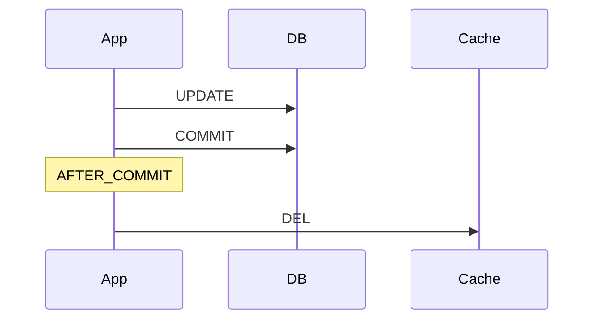

# After Commit Invalidate

> **커밋이 확정된 뒤에 버린다.**

아직 확정되지 않은 변경으로 캐시를 건드리지 않는다.
커밋 전에 지우면, 그 틈에 누군가 옛 값을 읽어 캐시에 도로 채워 넣을 수 있다.

---

커밋이 확정된 뒤에만 캐시를 삭제한다.

## 동작



## 구현

쓰기 코드는 바뀐 엔티티를 그대로 발행하고, 지울 키는 엔티티가 `CacheEvictable` 로 밝힌다.
별도 이벤트 타입을 만들지 않는다.

```java
public void changeEmail(Long id, String email) {
    User user = findUser(id);
    user.changeEmail(email);
    eventPublisher.publishEvent(user);
}
```

```java
@TransactionalEventListener(phase = TransactionPhase.AFTER_COMMIT)
public void evict(CacheEvictable entity) {
    entity.cacheKeys().forEach(this::evictOne);
}
```

Spring 이 엔티티를 `PayloadApplicationEvent` 로 감싸고, 인터페이스 타입으로 리스너를 고른다.

| 역할 | 소스 |
|-----|-----|
| 발행 | `after-commit-invalidate/.../user/UserCommandService.java` |
| 지울 키 선언 | `after-commit-invalidate/.../user/User.java` (`cacheKeys()`) |
| 삭제 | `after-commit-invalidate/.../cache/CacheEvictor.java` |

## 보장하는 것

| 항목 | 내용 |
|-----|-----|
| 커밋 전 재적재 제거 | 커밋 확정 후에만 삭제하므로 미커밋 값이 캐시에 남지 않는다 |
| 롤백 시 무동작 | 롤백되면 리스너가 호출되지 않는다 |
| 실행 순서 명시성 | `@CacheEvict`의 order 불확실성이 사라진다 |

일반적인 모놀리식·중간 규모 서비스에서는 이 구성까지가 현실적인 기본값이다.

## 보장하지 않는 것

| 항목 | 내용 |
|-----|-----|
| 커밋 후 유실 | 커밋 성공 직후 프로세스가 죽으면 DEL이 실행되지 않는다 |
| **발행 시점에 트랜잭션이 없는 경로** | `fallbackExecution` 기본값이 `false`라 **트랜잭션 없이 발행하면 이벤트가 폐기된다** |
| **실패의 가시성** | 삭제가 실패해도 **커밋은 성공하고 호출자는 모른다.** ERROR 로그 한 줄만 남는다 |
| 중복 제거 | 한 트랜잭션에서 같은 변경을 두 번 알리면 DEL도 두 번 나간다 |
| 리스너 내 DB 쓰기 | 원본 트랜잭션에 참여만 하고 커밋되지 않는다. `REQUIRES_NEW` 필요 (`미검증`) |
| 조회-갱신 경합 | 긴 조회와 겹치면 여전히 stale 적재 가능 |

배치·스케줄러처럼 트랜잭션 없이 도는 경로에서 무효화가 **조용히 누락**되는 것이 가장 위험하다.

### 예외는 호출자에게 전파되지 않는다

"AFTER_COMMIT 리스너의 예외가 `commit()` 호출자에게 전파되고 이후 순번 콜백이 끊긴다" 는
설명이 널리 인용되지만 **이름이 비슷한 `afterCommit()` 콜백과 혼동한 설명**이다.

`@TransactionalEventListener` 가 처음 나온 4.2 부터 이 단계는 `afterCommit()` 이 아니라
`afterCompletion(STATUS_COMMITTED)` 에서 실행되고
(`TransactionalApplicationListenerSynchronization$PlatformSynchronization`),
`TransactionSynchronizationUtils#invokeAfterCompletion` 은 콜백마다 `Throwable` 을 잡아 로그만 남긴다.
따라서 앞 순번 콜백이 터져도 **뒤 순번 리스너는 실행되고 호출자는 예외를 받지 않는다.**

전파되지 않는다는 것은 안전하다는 뜻이 아니라 **로그를 찾아보지 않으면 실패를 아무도 모른다는 뜻**이다.
`after-commit-invalidate` 모듈이 Spring 6.2.7 에서 이 동작을 테스트로 고정한다.

## 선택 기준

| 적합 | 부적합 |
|-----|-------|
| 트랜잭션 정확성이 필요한 일반 업무 데이터 | 무효화 유실까지 막아야 하는 경우 → [outbox-invalidate](outbox-invalidate.md) |

## 검증

```
☑ 커밋 성공 시에만 캐시가 삭제된다
☑ 롤백 시 캐시가 삭제되지 않는다
☑ 트랜잭션 없이 이벤트를 발행하면 리스너가 호출되지 않음을 확인한다
☑ 앞 순번 콜백이 터져도 삭제가 실행되고 호출자에게 전파되지 않음을 확인한다
☑ 캐시 저장소 장애 시 커밋이 성공하고 무효화만 유실됨을 확인한다
□ write-invalidate 대비 stale read 건수가 감소한다 (미측정)
```

구현 모듈: [`after-commit-invalidate`](../../after-commit-invalidate/README.md)

## 관련

- [write-invalidate.md](write-invalidate.md) · [entity-event-invalidate.md](entity-event-invalidate.md) · [dual-write.md](../concepts/dual-write.md)
