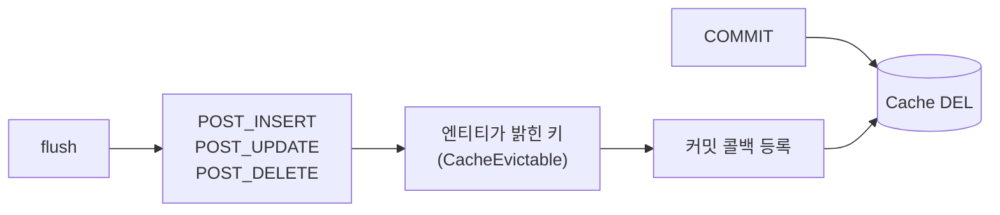

# Entity Event Invalidate

> **무효화를 선언하지 않고 파생시킨다.**

메서드마다 "이건 이 캐시를 지워라"라고 붙이지 않는다.
**엔티티가 바뀌었다는 사실 자체**에서 지울 키가 나온다.
어느 경로로 바꾸든 같은 이벤트가 발생하므로, 새 메서드를 추가해도 빠뜨릴 일이 없다.

---

하이버네이트 엔티티 이벤트로 지울 키를 모으고, 커밋 이후에 지운다.
무효화가 **메서드마다 선언되는 것이 아니라 엔티티 변경에서 파생**된다.

## 왜 이 방식인가

`@CacheEvict`를 메서드마다 붙이면 저장 쪽과 삭제 쪽이 각각 캐시 키를 알아야 하고,
새 서비스 메서드를 추가할 때 누락되면 조용히 stale이 남는다.
또한 [write-invalidate](write-invalidate.md)의 **실행 순서 불확실성**을 구조적으로 제거한다.

## 동작



`POST_COMMIT_*` 이벤트를 쓰지 않는다. 직접 발행한 엔티티와 같은 방식으로 지우기 위해,
flush 시점의 `POST_*` 로 받아 스프링 트랜잭션의 커밋 콜백에서 지운다.

조회는 `@Cacheable`만 남고, 쓰기 경로에는 캐시 코드가 없다.

## 구현

엔티티가 자기 키를 밝히고, 리스너는 그 엔티티만 골라 받는다.

```java
@Entity
public class User implements CacheEvictable {

    @Override
    public Set<CacheKey> cacheKeys() {
        return Set.of(
             CacheKey.of(CachePolicy.USER, id)
        );
    }
}
```

```java
public class CacheEvictListener extends JpaEntityEventListener<CacheEvictable> {

    @Override
    @TransactionalEventListener(phase = TransactionPhase.BEFORE_COMMIT, fallbackExecution = true)
    public void onEntityChanged(CacheEvictable entity) {   // 하이버네이트 이벤트와 직접 발행이 모두 여기로
        evictor.evict(cacheKeysOf(entity));
    }
}
```

`JpaEntityEventListener<T>` 는 타입 인자 `T` 를 읽어 그 타입의 엔티티만 넘긴다.
JPA 를 거치지 않는 쓰기는 엔티티를 그대로 `publishEvent` 하면 같은 메서드로 들어온다.

조회는 `@Cacheable` 만 선언하고, 엔티티가 아니라 **조회 전용 레코드**를 담는다.

```java
@Cacheable(cacheNames = CachePolicy.Name.USER, key = "#id")
public UserView findById(Long id) { ... }
```

## 보장하는 것

| 항목 | 내용 |
|-----|-----|
| 누락 방지 | 어느 서비스 메서드로 변경하든 영속성 컨텍스트를 거치면 무효화된다 |
| 실행 시점 확정 | flush 시점에 모아 커밋 이후에 지운다. 롤백이면 버린다 |
| 교차 엔티티 | 엔티티가 `cacheKeys()` 에 다른 캐시의 키를 함께 내놓으면 된다 |
| 책임 분리 | 조회는 `@Cacheable`만, 쓰기는 캐시를 모른다 |

## 보장하지 않는 것

| 경로 | 이유 |
|-----|-----|
| **벌크 연산** | `@Modifying` JPQL, 네이티브 UPDATE, Querydsl `update()` 는 영속성 컨텍스트를 거치지 않아 **이벤트가 발생하지 않는다**. 직접 발행으로 보완한다 |
| 목록·검색 캐시 | 엔티티는 자기 키만 알 뿐, 자신이 속한 목록 캐시를 모른다 |
| 다른 애플리케이션의 변경 | 리스너는 이 애플리케이션 안에서만 동작한다 → [cdc-invalidate](cdc-invalidate.md) |
| 커밋 후 유실 | 커밋 직후 프로세스가 죽으면 DEL이 실행되지 않는다 |
| 키 합의 | `@Cacheable`이 만든 키와 `cacheKeys()` 가 만든 키가 **다르면 조용히 실패한다** |
| 옛 키 | 자연키가 바뀌면 바뀐 뒤의 키만 안다. 이전 상태를 싣지 않으므로 옛 키는 TTL 이 지운다 |

벌크 연산 경로가 존재한다면 TTL이 유일한 복구 수단이 된다.

## 선택 기준

| 적합 | 부적합 |
|-----|-------|
| JPA/Hibernate 기반, 단일 애플리케이션이 DB를 수정 | 벌크 연산·외부 앱이 DB를 자주 수정하는 환경 |

## PoC 구현

이 전략의 실행 코드는 `write-invalidate` 모듈에 있다.
`@CacheEvict`와 나란히 두어 **같은 상황에서 결과가 갈리는 지점**을 테스트로 고정했다.
→ [write-invalidate.md](write-invalidate.md#poc-구현)

## 검증

`write-invalidate` 모듈에서 통과한 항목은 체크되어 있다.

```
☑ UPDATE / DELETE 에서 캐시가 무효화된다
☑ @Cacheable이 적재한 키와 CacheEvictable이 무효화하는 키가 일치한다
☑ 롤백 시 무효화가 수행되지 않는다
☑ CacheEvictable 미구현 엔티티는 같은 커밋에서도 무효화되지 않는다
☑ 무효화 대상 키 산출이 추가 DB 조회를 유발하지 않는다
□ INSERT 직후 조회에서 캐시가 무효 상태임을 확인한다
☑ 엔티티가 키를 내놓다 예외를 던져도 트랜잭션은 그대로 커밋된다
□ 벌크 UPDATE는 이벤트를 발생시키지 않음을 확인한다 (한계 고정)
```

## 관련

- [after-commit-invalidate.md](after-commit-invalidate.md) · [cdc-invalidate.md](cdc-invalidate.md) · [metrics.md](../concepts/metrics.md)
