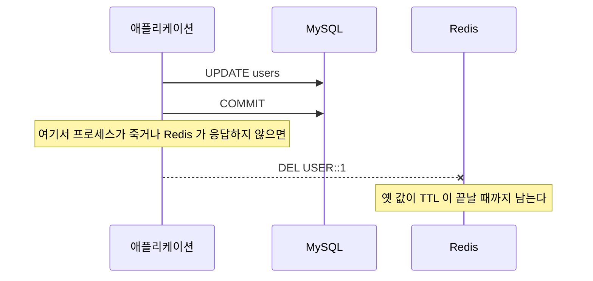
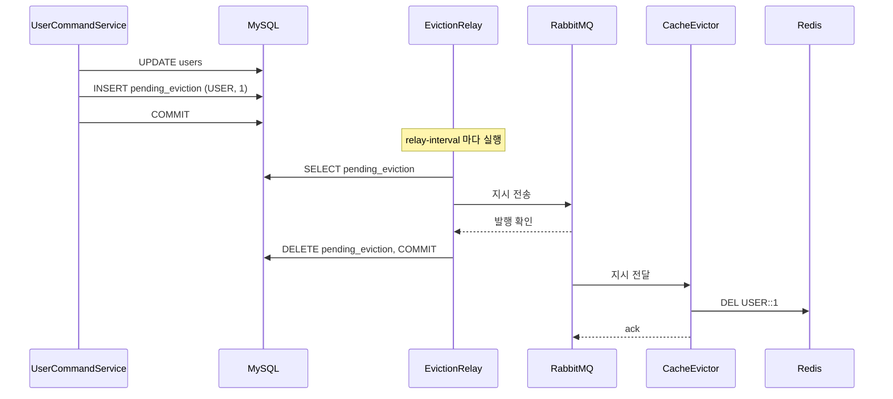

# Outbox Invalidate

데이터를 변경할 때, 같은 트랜잭션에서 삭제할 캐시 키를 DB 테이블에 함께 기록한다.
삭제 지시가 DB 에 남으므로, 커밋 직후 애플리케이션이 종료되거나 Redis 가 잠시 응답하지 않아도 나중에 그 지시를 실행해 캐시를 삭제할 수 있다.
이 모듈은 이 방식(transactional outbox)이 무엇을 복구하고 무엇을 여전히 놓치는지를 테스트로 확인한다.

## Environment

- Java 21
- Spring Boot 3.5.0 (spring-context 6.2.7, spring-amqp 3.2)
- MySQL 8.4.4
- Redis 7
- RabbitMQ 4

## 왜 필요한가

이 저장소의 전략 모듈은 데이터를 바꾸면 관련 캐시를 지운다.
그중 [after-commit-invalidate](../after-commit-invalidate/README.md) 는 트랜잭션이 커밋되면 실행할 작업을 애플리케이션 메모리에 등록해 두고,
커밋 직후 같은 프로세스에서 Redis `DEL` 을 보낸다.
어떤 캐시 키를 지워야 하는지는 메모리에만 있으므로, 프로세스가 종료되면 그 정보도 함께 사라진다.



DB 데이터를 바꾸고 Redis 캐시를 지우는 일은 서로 다른 저장소에 대한 쓰기(dual write)다. 두 작업을 하나의 트랜잭션으로 묶을 수 없으므로, DB 커밋은 성공해도 Redis 캐시 삭제는 실패할 수 있다.
메모리에 등록한 작업으로 지우는 방식은 이 실패를 기록해 둘 곳이 없다.
after-commit-invalidate 의 테스트도 Redis 장애가 나면 DB 변경은 커밋되지만 캐시 삭제는 실패하고, 데이터 변경을 요청한 쪽에는 이 실패가 전달되지 않는 것을 확인한다.

## 전략

삭제 지시를 메모리가 아니라 DB 에 둔다. 데이터 변경과 지시 기록을 같은 트랜잭션에 넣으면 둘은 함께 커밋되거나 함께 롤백된다.
커밋된 지시는 릴레이가 DB 에서 읽어 RabbitMQ 로 보내고, 메시지를 받은 소비자가 Redis 캐시를 삭제한다.

## 먼저 알아 둘 용어

| 용어 | 뜻 |
|-----|---|
| outbox | 커밋된 뒤 밖으로 보낼 메시지를 담아 두는 테이블. 이 모듈에서는 `pending_eviction` 이다 |
| 릴레이 | outbox 테이블의 행을 주기적으로 읽어 메시지 브로커(RabbitMQ)로 보내는 작업 (`EvictionRelay`) |
| 소비자 | 브로커에서 메시지를 받아 Redis 캐시를 지우는 리스너 (`CacheEvictor`) |
| 발행 확인 | 브로커가 메시지를 받았다고 보내는 응답(publisher confirm). 릴레이는 이 응답을 받은 뒤에만 행을 지운다 |
| at-least-once | 메시지가 한 번 이상 전달될 수 있는 방식. 이 모듈에서는 릴레이가 같은 삭제 지시를 RabbitMQ 에 다시 보낼 수 있어, 소비자가 같은 지시를 여러 번 처리할 수 있다 |
| 캐시 정책 | 캐시 이름과 TTL 을 정한 선언 (`CachePolicy`). 삭제 지시는 정책(`USER`)과 키(`1`)로 이루어지고, Redis 에서는 `USER::1` 키가 된다 |

## 흐름



1. `UserCommandService` 가 사용자 데이터를 바꾸고, 같은 트랜잭션에서 `EvictionOutbox#record` 로 캐시 정책(`USER`)과 키(`1`)를 `pending_eviction` 에 기록한다.
2. `EvictionRelay` 가 `service.cache.outbox.relay-interval` 마다 대기 행을 읽어 RabbitMQ 로 보낸다. 브로커의 발행 확인을 받은 뒤 행을 지운다.
3. `CacheEvictor` 가 메시지를 받아 Redis 에서 `USER::1` 을 지운다. 처리에 실패하면 메시지를 큐로 되돌려 다시 받는다.

## 단계별 장애와 결과

| 장애 지점 | 결과 |
|---------|-----|
| 커밋 전에 죽음 | 데이터 변경과 삭제 지시가 함께 롤백된다. 데이터가 바뀌지 않았으므로 캐시를 지울 필요도 없다 |
| 커밋 후, 릴레이 전에 죽음 | 지시가 테이블에 남는다. 재기동한 릴레이가 보낸다 |
| 릴레이가 보낼 때 브로커가 죽어 있음 | 예외로 릴레이 트랜잭션이 롤백되어 행이 남는다. 다음 주기에 다시 보낸다 |
| 브로커가 받은 뒤, 행 삭제를 커밋하기 전에 죽음 | 행이 남아 같은 지시를 한 번 더 보낸다 |
| 소비자가 처리하는 중 Redis 가 실패함 | 메시지가 큐로 돌아가 다시 전달된다 |
| 정책에 없는 캐시를 지목함 | 다시 받아도 처리할 수 없으므로 버린다 |

## 같은 지시를 두 번 보내도 되는 이유

릴레이는 브로커가 받은 뒤 행을 지우기 전에 죽으면 같은 지시를 다시 보낸다. 이 모듈은 이 중복을 걸러 내지 않는다.
캐시 삭제는 몇 번을 해도 결과가 같기 때문이다.

이미 삭제된 키를 다시 삭제해도 이전 값이 복원되지는 않는다. 그 사이 캐시에 값이 다시 저장되었다면 그 값도 삭제되므로,
다음 조회에서 캐시 미스(MISS)가 나 DB 에서 값을 다시 읽는다.
삭제 지시가 늦게 도착하거나 전달 순서가 바뀌어도 이전 값을 되살리지는 않는다. 삭제 지시에는 캐시 값이 들어 있지 않기 때문이다.

반면 [write-update](../write-update/README.md) 처럼 캐시 값을 직접 갱신하는 방식에서는 메시지의 중복 전달이나 순서 역전으로 이전 값이 다시 저장될 수 있다.
그 방식이라면 메시지 중복과 처리 순서를 따로 관리해야 한다.

## 트랜잭션이 없으면 기록을 거부한다

`EvictionOutbox#record` 는 `@Transactional(propagation = MANDATORY)` 다. 열린 트랜잭션이 없으면 `IllegalTransactionStateException` 을 던진다.

데이터 변경과 삭제 지시를 별도 트랜잭션으로 처리하면, 데이터 변경이 커밋된 뒤 지시를 기록하기 전에 애플리케이션이 종료될 수 있다.
이 경우 변경된 데이터는 남지만 캐시 삭제 지시는 기록되지 않는다. 그래서 같은 트랜잭션 안에서만 기록을 허용한다.

after-commit-invalidate 는 트랜잭션 없이 이벤트를 발행하면 이벤트를 조용히 버리고 DB 만 바꾼다.
이 모듈은 쓰기 자체를 실패시켜 호출자가 바로 알게 한다.

## 보장하는 것

| 상황 | 결과 |
|-----|-----|
| 변경 커밋 | 지울 키가 같은 트랜잭션으로 `pending_eviction` 에 남는다 (등록·수정·삭제 모두) |
| 변경 롤백 | 지시도 남지 않는다 |
| 커밋 직후 애플리케이션이 죽음 | 지시가 DB 에 남아, 릴레이가 다시 돌면 캐시가 지워진다 |
| 브로커 장애 | 지시를 지우지 않고 다음 주기에 보낸다 |
| Redis 일시 장애 | 삭제에 실패한 메시지를 다시 전달받아 재시도한다. Redis 가 복구되면 캐시가 지워진다 |
| 중복 전달 | 최종 캐시 상태가 같다 |

## 보장하지 않는 것

삭제 지시가 사라지지 않게 하는 것과 캐시를 즉시 삭제하는 것은 별개다. 다음 상황에서는 삭제가 늦어지거나 같은 작업이 여러 번 일어난다.

| 상황 | 이 모듈의 동작 |
|-----|-------------|
| 캐시 삭제 지연 | 릴레이가 실행되기 전까지 기존 캐시 값이 남아 있을 수 있다. 정상일 때도 `relay-interval` 주기에 따른 대기와 브로커 전달·소비자 처리 시간이 더해지고, 장애가 나면 삭제가 더 늦어진다 |
| 삭제 지시 누락 | 쓰기 메서드에서 `record` 호출을 빠뜨리면 지시가 없다. after-commit-invalidate 에서 `publishEvent` 를 빠뜨리는 것과 같은 약점이다 |
| JPA 를 거치지 않는 변경 | 벌크 UPDATE·직접 SQL 은 `record` 를 부르지 않으면 지시가 생기지 않는다 |
| Redis 장애 중 반복 재시도 | 소비자가 실패한 메시지를 바로 큐로 되돌려, 장애 동안 같은 메시지를 계속 다시 받는다. 재시도 간격과 dead-letter 큐는 구현하지 않았다 |
| 다중 릴레이 실행 | 여러 인스턴스의 릴레이가 같은 행을 읽어 같은 지시를 여러 번 보낸다. 결과는 같지만 메시지가 늘어난다 |
| 브로커 응답 대기 중 트랜잭션 유지 | 릴레이는 브로커의 발행 확인을 기다리는 동안 DB 트랜잭션을 열어 둔다 |

outbox 는 삭제 지시를 DB 변경과 함께 커밋해 dual write 의 한쪽만 성공하는 문제를 줄이지만, 실제 캐시 삭제가 끝나는 시간을 앞당기지는 않는다.

삭제 지시 누락과 JPA 밖의 변경은 DB 변경 로그에서 데이터 변경을 감지하는 CDC(Change Data Capture) 방식으로 다룰 수 있다.
[cdc-invalidate](../docs/invalidation/cdc-invalidate.md) 는 애플리케이션이 삭제 지시를 직접 기록하지 않는 방식을 설명한다.

## 테스트가 고정한 동작

테스트는 프로세스를 실제로 종료하지 않는다. "커밋 직후 죽어 릴레이가 돌지 않은 상태" 는 릴레이를 호출하지 않는 것으로 만든다.
릴레이는 메모리에 처리 상태를 두지 않고 DB 의 대기 행만 읽는다. 그래서 프로세스를 재기동하지 않고도, 재기동 후 릴레이가 남아 있는 지시를 읽는 상황을 검증할 수 있다.
테스트 설정은 `relay-interval` 을 1시간으로 두어 릴레이의 자동 실행을 막고, 검증이 필요한 시점에 테스트가 직접 호출한다.

`EvictionOutboxTest` — 지시 기록

| 상황 | 결과 |
|-----|-----|
| 수정·삭제·등록이 커밋됨 | 지울 키가 대기 행으로 남는다 |
| 바깥 트랜잭션이 롤백됨 | 대기 행이 남지 않는다 |
| 트랜잭션 없이 `record` 호출 | `IllegalTransactionStateException` |

`EvictionRelayTest` — 릴레이부터 캐시 삭제까지

| 상황 | 결과 |
|-----|-----|
| 커밋 후 릴레이가 돌지 않음 | 캐시에는 이전 값, DB 에는 지시가 남아 있다 |
| 릴레이 실행 | 캐시가 지워지고 대기 행이 비워진다 |
| 브로커 연결 실패 | 대기 행이 유지되고, 다음 릴레이 실행에서 다시 보내 캐시가 지워진다 |
| 보낸 뒤 행 삭제가 롤백됨 | 같은 지시를 다시 보내고, 최종 조회 값은 최신이다 |

`CacheEvictorTest` — 소비자

| 상황 | 결과 |
|-----|-----|
| 소비자의 캐시 삭제가 한 번 실패 | 실패한 메시지를 다시 전달받아 캐시를 지운다 |
| 정책에 없는 캐시 | 한 번만 받고 버린다 |

Redis 와 RabbitMQ 장애는 `CacheManager`, `RabbitTemplate` 에 Mockito spy 를 적용해 재현한다.
Spring 은 테스트마다 spy 설정이 다르면 애플리케이션 컨텍스트를 따로 만든다. 그러면 컨텍스트마다 RabbitMQ 소비자가 등록되어 같은 큐의 메시지를 나누어 받고,
장애를 재현하지 않은 쪽 소비자가 메시지를 가져갈 수 있다.
이를 막기 위해 모든 통합 테스트가 `OutboxIntegrationTest` 애노테이션으로 같은 spy 설정을 쓴다.

## 구성

| 클래스 | 역할 |
|-------|-----|
| `cache/EvictionOutbox` | 쓰기 트랜잭션 안에서 지울 키를 `pending_eviction` 에 적는다 |
| `cache/PendingEviction` | outbox 테이블의 한 행. 캐시 정책과 키 |
| `cache/EvictionRelay` | 대기 행을 브로커로 보내고, 발행 확인 뒤 행을 지운다 |
| `cache/CacheEvictor` | `@RabbitListener` 로 지시를 받아 캐시를 지운다 |
| `config/MessagingConfig` | durable 큐, JSON 메시지 변환기 |
| `config/RelayConfig` | 릴레이를 `relay-interval` 마다 실행한다 |
| `config/ServiceCacheProperties` | `service.cache.clear.*`, `service.cache.outbox.*` |
| `config/CacheConfig`, `config/CachePolicy` | 다른 모듈과 같은 캐시 설정 ([ttl-only](../ttl-only/README.md#설정)) |

## 실행

환경에 따라 두 방식 중 하나를 고른다.

```bash
# 로컬: docker compose 로 MySQL·Redis·RabbitMQ 를 띄운 뒤 실행
docker compose -f _settings/docker/docker-compose.yml up -d mysql redis rabbitmq
./gradlew :spring-cache:cache-invalidation-strategy:outbox-invalidate:test

# Testcontainers: 테스트가 컨테이너를 직접 띄워 실행
./gradlew :spring-cache:cache-invalidation-strategy:outbox-invalidate:test -Ptestcontainers
```

RabbitMQ 컨테이너는 이 모듈만 쓰므로 공용 테스트 모듈이 아니라 이 모듈의 `RabbitContainerConfig` 가 띄운다.

## 더 알아보기

- [docs/invalidation/outbox-invalidate.md](../docs/invalidation/outbox-invalidate.md): outbox 무효화의 보장 범위와 운용 제약
- [docs/concepts/dual-write.md](../docs/concepts/dual-write.md): DB 와 캐시에 따로 쓸 때 생기는 불일치
- [docs/invalidation/cdc-invalidate.md](../docs/invalidation/cdc-invalidate.md): DB 변경 로그로 무효화하는 방식
- [Microservices.io - Transactional outbox](https://microservices.io/patterns/data/transactional-outbox.html)
- [RabbitMQ - Consumer Acknowledgements and Publisher Confirms](https://www.rabbitmq.com/docs/confirms)
