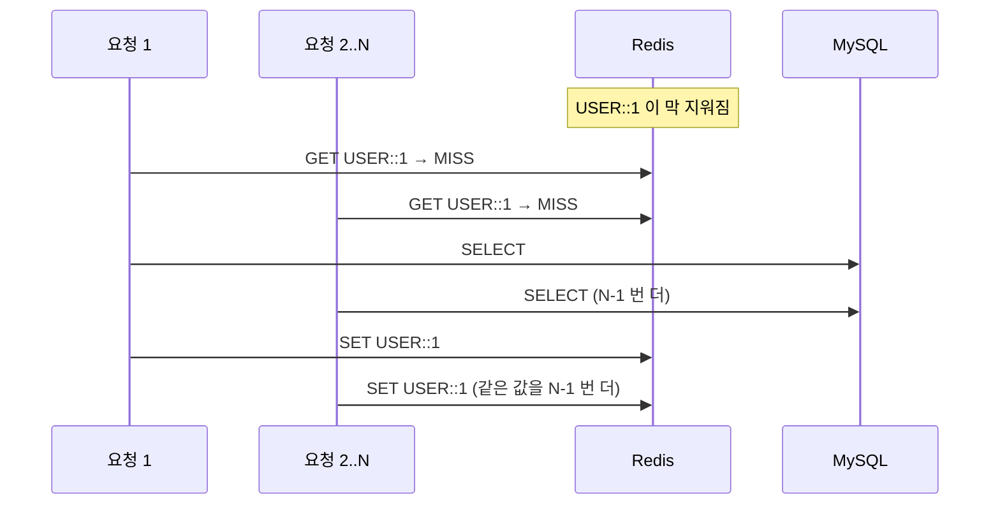
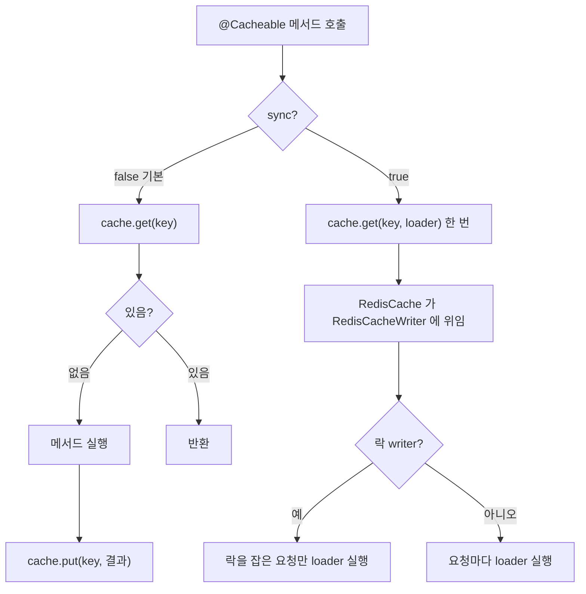
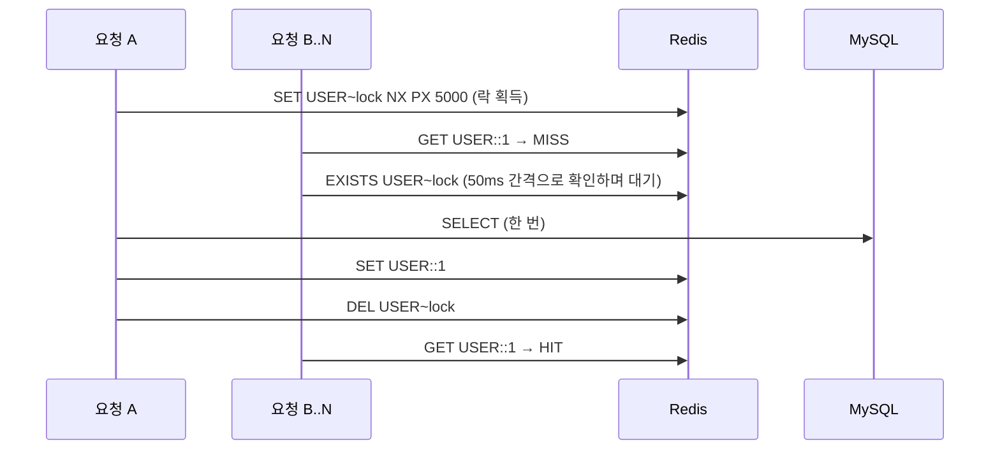

# Stampede Guard

캐시 키가 비어 있는 순간 같은 키로 조회가 몰리면, 요청마다 DB 를 읽는다. 이것을 cache stampede 라고 한다.
이 모듈은 Spring Cache 의 `@Cacheable(sync = true)` 와 Spring Data Redis 의 락을 사용하는 `RedisCacheWriter` 를 함께 썼을 때
stampede 를 어디까지 막는지, 그리고 어떤 한계가 남는지를 테스트로 확인한다.

## Environment

- Java 21
- Spring Boot 3.5.0 (spring-context 6.2.7, spring-data-redis 3.5.0)
- MySQL 8.4.4
- Redis 7

## stampede 는 왜 생기나

이 저장소(`cache-invalidation-strategy`)의 각 캐시 전략 모듈은 Cache-Aside 방식을 사용한다.
데이터를 바꾸면 기존 캐시를 지우기만 하고, 그 뒤 첫 조회 요청이 DB 를 읽어 캐시를 다시 채운다.

그런데 캐시 키가 삭제된 뒤 다시 채워지기 전까지 같은 키 조회가 동시에 들어오면, 요청이 모두 MISS 를 확인하고
각자 DB 를 조회한 뒤 같은 값을 캐시에 저장한다.



### 언제 생기나

대표적인 경우는 다음과 같다.

| 원인 | 예 |
|-----|---|
| 무효화 직후 | 인기 상품의 가격을 바꿔 캐시를 지웠다 |
| TTL 만료 | 메인 화면 데이터의 TTL 이 끝났다 |
| 캐시 전체 초기화 직후 | 배포나 Redis 재시작으로 캐시가 비었다. 이때는 여러 키에서 동시에 MISS 가 난다 |

### 왜 위험한가

평소 캐시가 받아 주던 조회가 한꺼번에 DB 로 간다.
조회 시간이 길수록 DB 커넥션을 오래 점유하고, 커넥션 풀이 고갈되면 이 캐시와 무관한 요청까지 지연된다.
응답 지연으로 타임아웃과 재시도가 생기면 DB 요청은 더 늘어난다.

### 정확한 무효화가 stampede 를 늘린다

앞선 무효화 모듈(`write-invalidate`, `after-commit-invalidate`)은 데이터가 바뀔 때마다 관련 캐시를 바로 지운다.
쓰기마다 캐시를 즉시 지우므로, 인기 키는 쓰기 횟수만큼 "키가 비는 순간" 을 반복해서 겪는다.
이 모듈은 그 결과로 생기는 무효화 직후의 동시 MISS 를 다룬다.

### 비슷하지만 다른 문제

- cache penetration: 원본 DB 에도 없는 값을 반복 조회해 매번 DB 까지 가는 문제
- cache avalanche: 많은 캐시 키가 비슷한 시점에 한꺼번에 만료되거나 캐시 전체가 사라지는 문제

두 문제는 [cache-failure-modes.md](../docs/concepts/cache-failure-modes.md) 에서 비교한다.

## 전략

같은 키에서 동시에 MISS 가 나면 한 요청만 DB 를 읽어 캐시에 넣고, 나머지는 기다렸다가 캐시를 읽는다.
이렇게 같은 키의 동시 조회를 원본 조회 한 번으로 합치는 방식을 흔히 single-flight 라고 부른다.
이 모듈은 Spring Cache 와 Spring Data Redis 가 제공하는 기능만으로 single-flight 를 구현하며, 동시 적재를 막는 수단으로 Redis 락을 쓴다.

## 먼저 알아 둘 용어

| 용어 | 뜻 |
|-----|---|
| `RedisCacheWriter` | Spring Data Redis 의 `RedisCache` 가 실제 Redis 읽기·쓰기를 맡기는 객체. 락을 쓰지 않는 방식(기본)과 락을 쓰는 방식으로 만들 수 있다 |
| 락 writer | 락을 쓰는 방식으로 만든 `RedisCacheWriter`. 캐시에 값을 채우거나 캐시를 비우기 전에 Redis 에 락 키를 잡는다 |
| loader | 캐시 MISS 일 때 실제 메서드를 실행해 값을 만드는 콜백 |

## 흐름

### 1. `@Cacheable(sync = true)` 가 호출 방식을 어떻게 바꾸는가



`sync = false` 이면 조회(`get`)와 적재(`put`)가 분리되어 있어, 그 사이에 다른 요청도 같은 MISS 를 확인할 수 있다.
`sync = true` 이면 Spring 은 `cache.get(key, loader)` 로 조회와 값 생성을 함께 캐시에 맡긴다.
다만 `sync = true` 자체가 동시 요청을 줄 세우지는 않는다. 동시 적재를 막을지는 캐시 구현체가 정한다.

### 2. 락 writer 와 `@Cacheable(sync = true)` 로 막았을 때

락 writer 는 MISS 를 확인한 뒤 loader 를 실행하기 전에 락을 확인한다.



`SET ... NX` 는 락 키가 없을 때만 값을 저장하고, `PX 5000` 은 락에 5초 만료를 둔다.
확인 간격 50ms 와 락 만료 5초는 이 모듈의 `CacheConfig` 에서 정한 값이다.

## `sync = true` 만으로는 막히지 않는다

`@Cacheable` 의 `sync` 는 캐시 구현체에 "같은 키의 값 생성을 한 번만 수행해 달라" 고 요청할 뿐, 실제 직렬화를 보장하지 않는다.
Javadoc 도 "the chosen cache provider might not actually support it" 라고 적는다.

| 단계 | 하는 일 | 소스 |
|-----|-------|-----|
| Spring | `sync = true` 면 `Cache#get(key, loader)`, 아니면 `get` 후 `put` | `CacheAspectSupport#executeSynchronized` |
| RedisCache | `get(key, loader)` 를 `RedisCacheWriter` 에 위임 | `RedisCache#get(Object, Callable)` |
| RedisCacheWriter | 락 writer 일 때만 `<캐시 이름>~lock` 을 `SET NX` 로 잡고 적재 | `DefaultRedisCacheWriter#get`, `#doLock` |

따라서 이 모듈의 Redis 구성에서 stampede 를 막으려면 `@Cacheable(sync = true)` 와 락 writer 가 함께 필요하다.

| | 락 없는 writer | 락 writer |
|---|---|---|
| `sync` 없음 (`get` → `put`) | N 번 적재 | N 번 적재 |
| `sync = true` (`get(key, loader)`) | N 번 적재 | 1 번 적재 |

이 저장소의 다른 전략 모듈(`ttl-only`, `write-invalidate`, `after-commit-invalidate`, `write-update`)은
락 없는 writer(`nonLockingRedisCacheWriter`)를 쓴다. 그 구성에 `sync = true` 만 더해도 같은 키의 중복 적재는 줄지 않는다.

## 락 writer 의 한계

| 한계 | 결과 |
|-----|-----|
| 락 범위가 캐시 이름 전체다 | 같은 캐시 이름에 속한 서로 다른 키도 같은 락을 공유한다. 한 키를 적재하는 동안 다른 키의 적재도 대기한다 |
| 락 키에는 캐시 키의 key-prefix 가 붙지 않는다 | 같은 Redis 를 쓰는 다른 애플리케이션이 같은 캐시 이름을 쓰면 서로의 적재를 막는다 |
| 기본 구성의 락에는 만료 시간이 없다 | `lockingRedisCacheWriter(factory)` 는 `TtlFunction.persistent()` 를 쓴다. 락을 잡은 요청이 적재 중에 죽으면 그 캐시의 적재가 영원히 멈춘다 |
| 기본 구성에서는 락 대기에도 상한이 없다 | 기다리는 요청은 락이 사라질 때까지 확인을 반복한다(`checkAndPotentiallyWaitUntilUnlocked`). 락 TTL 도 없으므로 락이 남아 있는 한 요청 스레드가 계속 대기한다 |

이 락은 프로세스 내부 락이 아니라 Redis 에 두는 분산 락이다.
애플리케이션 인스턴스가 여러 대여도 같은 캐시의 적재는 한 요청만 진행하지만, 락 확인만큼 Redis 왕복이 추가된다.

이 모듈은 락 TTL 을 5초로 설정했다. 락이 정상적으로 해제되지 않아도 5초가 지나면 기다리던 요청이 다시 진행할 수 있다.
적재가 5초보다 오래 걸리면 락이 먼저 만료되어 다른 요청도 DB 를 읽는다.

## 한계를 줄이는 대책

아래 대책은 이 모듈에 구현하지 않았다. 원리와 흐름, 구현 포인트는 개념 문서에서 설명한다.

| 문제 | 대책 | 더 알아보기 |
|-----|-----|----------|
| 캐시 이름 단위 락 때문에 다른 키까지 대기하고, 대기 시간에도 상한이 없다 | 키 단위 분산 락을 쓰고, 일정 시간 넘게 기다리면 락 대기를 멈추고 DB 를 직접 조회한다 | [키 단위 락 구현 포인트](../docs/concepts/stampede.md#키-단위-락-구현-포인트) |
| 같은 캐시 이름을 쓰는 다른 애플리케이션과 락이 충돌한다 | 캐시 이름에 애플리케이션 식별자를 넣는다 | [락 writer 의 한계와 대책](../docs/concepts/stampede.md#락-writer-의-한계와-대책) |
| TTL 만료 시점에 동시 MISS 가 발생한다 | 만료 전에 일부 요청이 확률적으로 캐시를 미리 갱신하는 XFetch | [XFetch](../docs/concepts/stampede.md#probabilistic-early-expiration-xfetch) |
| TTL 만료 뒤 새 값이 준비될 때까지 응답이 지연된다 | 만료된 기존 값을 먼저 돌려주고 백그라운드에서 갱신하는 SWR | [Stale-While-Revalidate](../docs/concepts/stampede.md#stale-while-revalidate) |

XFetch 와 SWR 은 TTL 만료에 대비하는 방법이다. 둘 다 아직 남아 있는 값을 이용하는데,
무효화로 키를 삭제하면 재사용할 기존 캐시 값이 남아 있지 않다.
키가 삭제된 직후의 동시 MISS 에는 single-flight 가 직접적인 대응책이다.

## 구성

| 클래스 | 역할 |
|-------|-----|
| `config/CacheConfig` | 재시도 간격 50ms, 락 TTL 5초, `SCAN` 기반으로 캐시 전체 삭제를 수행하는 `RedisCacheWriter` 를 캐시 관리자에 설정한다 |
| `user/UserQueryService` | `@Cacheable(sync = true)` 로 사용자를 조회한다 |
| `user/UserCommandService` | 사용자 등록만 한다. 이 모듈의 검증 대상은 조회 흐름이라 무효화 로직은 두지 않는다 |

## 테스트가 고정한 동작

`CacheStampedeTest` 는 Spring 서비스 없이 `RedisCache` 와 `RedisCacheWriter` 만으로 동시 적재를 검증한다.
loader 실행에 0.5초가 걸리도록 하고, 8개 요청을 동시에 실행한다.

| 상황 | 결과 |
|-----|-----|
| 락 없는 writer + `get(key, loader)` | 8 번 적재 |
| 락 writer + `get` → `put` | 8 번 적재 |
| 락 writer + `get(key, loader)` | 1 번 적재 |
| 락 writer, 같은 캐시 이름의 한 키가 적재 중 | 기존 키의 적재가 끝날 때까지 다른 키의 적재도 시작되지 않는다 |
| 락 writer, key-prefix 만 다른 두 캐시 관리자 | 캐시 이름이 같으면 서로의 적재를 막는다 |
| 기본 구성의 락 writer | 락 키의 TTL 이 -1 (만료 없음) |

key-prefix 만 다른 두 캐시 관리자 테스트는, 같은 Redis 를 쓰는 두 애플리케이션이 캐시 이름만 같을 때 락 키가 충돌하는 상황을 재현한다.

`UserQueryServiceTest` 는 실제 서비스(`UserQueryService`)를 거치는 시나리오다.

| 상황 | 결과 |
|-----|-----|
| 테스트가 캐시를 직접 비운 직후 같은 사용자 조회 8건 | DB 는 한 번만 읽고, 모두 같은 값을 받는다 |

writer 를 락 없는 방식으로 바꾸거나 `sync = true` 를 지우면, DB 조회 1회를 확인하는 테스트(`readsDatabaseOnce`)가 실패한다.

캐시 전체 삭제도 같은 락을 잡는다. `CacheConfigTest` 는 이때 잡는 락에도 설정한 TTL 이 적용되는지 확인한다.

## 실행

```bash
./gradlew :spring-cache:cache-invalidation-strategy:stampede-guard:test
./gradlew :spring-cache:cache-invalidation-strategy:stampede-guard:test -Ptestcontainers
```

첫 번째 명령은 로컬 공유 DB·Redis(`_settings/docker/docker-compose.yml`)를 쓴다.
`-Ptestcontainers` 를 붙이면 테스트용 DB·Redis 컨테이너를 띄우고, 테스트가 그 컨테이너의 접속 정보를 쓰도록 바꿔 실행한다.

## 더 알아보기

- [docs/concepts/stampede.md](../docs/concepts/stampede.md): single-flight, XFetch, SWR 의 원리와 구현 포인트
- [docs/concepts/cache-failure-modes.md](../docs/concepts/cache-failure-modes.md): stampede, penetration, avalanche 구분
- [Redis - Cache-aside](https://redis.io/docs/latest/develop/use-cases/cache-aside/)
- [Vattani et al., Optimal Probabilistic Cache Stampede Prevention, VLDB 2015](http://www.vldb.org/pvldb/vol8/p886-vattani.pdf)
- [RFC 5861 - stale-while-revalidate](https://www.rfc-editor.org/rfc/rfc5861.html)
