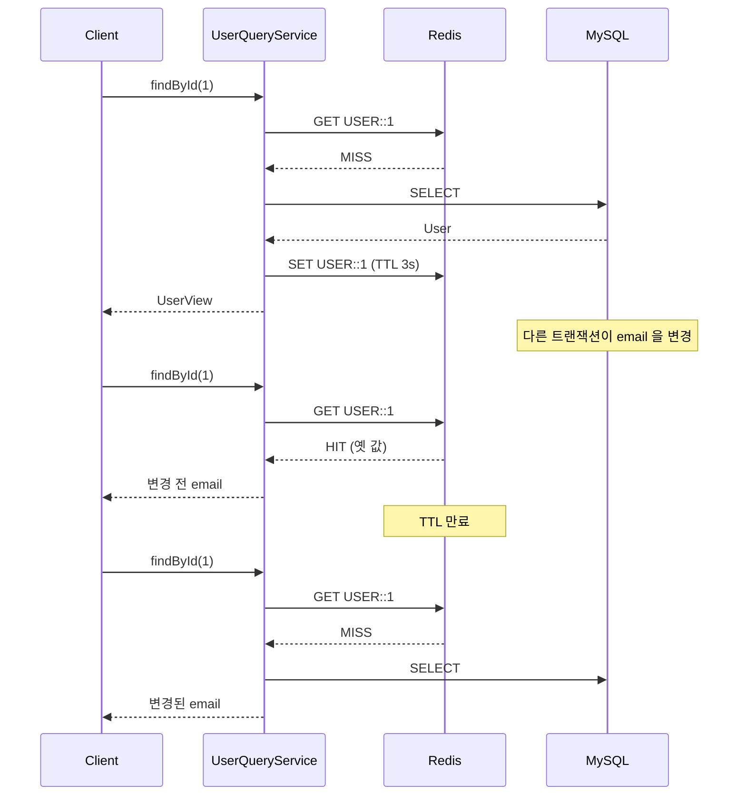

# TTL Only

**DB가 바뀌어도 캐시를 지우지 않는** 전략이다.
키가 스스로 만료될 때까지 기다릴 뿐, 낡았다고 알려 주는 코드가 한 줄도 없다.

그래서 이 모듈이 증명하려는 명제는 하나다.
**옛 값이 보이는 기간의 상한이 TTL과 일치한다.**
상한이 확정되면 "얼마나 틀릴 수 있는가"를 숫자로 답할 수 있고,
그 숫자를 받아들일 수 있는 데이터라면 지우는 장치가 아예 필요 없다.

## Environment

- Java 21
- Spring Boot 3.5.0
- Hibernate 6.6.15.Final
- MySQL 8.4.4
- Redis 7
- Testcontainers 1.21.3

## 동작



변경을 캐시에 전파하는 경로가 없다.
최신성은 오직 TTL이 끝나는 시점에만 회복된다.

## 구성

| 클래스 | 역할 |
|-------|-----|
| `CachePolicy` | 이 모듈의 캐시 이름·TTL·값 타입을 enum 하나에 선언한다 |
| `UserQueryService` | `@Cacheable` 만 선언한다 |
| `UserCommandService` | 캐시를 전혀 모른다 |

정책에는 무효화에 관한 말이 한 마디도 없다.

## 설정

이 모듈에 필요한 것만 `config` 패키지에 직접 선언한다.
다른 모듈과 코드가 겹치는 것은 감수한다.

| 클래스 | 역할 |
|-------|-----|
| `CachePolicy` | 캐시 이름·TTL·값 타입 선언 |
| `CacheConfig` | 아래 빈 등록과 값 직렬화 |
| `ServiceCacheProperties` | `service.cache.*` 바인딩 |

TTL 은 `CachePolicy` 가 정한다. 이 모듈은 TTL 로만 최신성을 회복하므로 그 값이 곧 stale 상한이다.
생략하면 5분이고, 적으면 뒤에 덧붙인다. 선택값인 TTL 을 맨 뒤에 두어 기본값과 다른 캐시만 눈에 띄게 한다.

```java
USER(Name.USER, UserView.class, Duration.ofSeconds(3)),   // TTL 을 적으면 기본값(5분)을 덮어쓴다
PROFILE(Name.PROFILE, ProfileView.class);                  // 생략하면 5분
```

이름이 겹치는 정책은 따로 검사하지 않는다. 캐시 설정을 만들 때 `Collectors.toMap` 이 같은 이름에서 기동을 막는다.
키 직렬화기도 지정하지 않는다. Spring Data Redis 기본값이 이미 문자열이다.

등록하는 빈은 둘이다.

| 빈 | 이유 |
|---|---|
| `cacheManagerCustomizer` | 정책별 TTL·직렬화, `SCAN` 으로 비우기, 정책 없는 캐시명 조회 차단, `spring.cache.cache-names` 금지 |
| `errorHandler` | Redis 가 죽으면 DB 조회로 넘어간다 |

무효화 파이프라인과 기동 검증기는 등록하지 않는다. 앞의 것은 지우는 일이 없어 쓸 데가 없고,
검증기는 설정 실수를 막는 보조 장치라 TTL 명제와 무관하다.

캐시 이름은 `CachePolicy` 에서만 나온다. `spring.cache.cache-names` 는 값이 무엇이든 기동을 막는다.
Boot 는 그 속성의 캐시를 커스터마이저보다 먼저 기본 설정(JDK 직렬화, 만료 없음)으로 만들어 두므로,
두 곳에서 이름을 받으면 어느 쪽이 빠졌는지 따지는 검사가 따로 필요해진다. 한 곳으로 모으면 그 검사가 필요 없다.

Boot 표준으로 표현할 수 있는 값은 `spring.cache.redis.*` 에, 그렇지 않은 값만 `service.cache` 아래에 둔다.

```yaml
spring:
  cache:
    redis:
      key-prefix: "cache-ttl-only:"
      # time-to-live: 5m        # 스프링 표준 기본 TTL. 지금은 CachePolicy 가 TTL 을 정하므로 쓰지 않는다
      enable-statistics: true

service:
  cache:
    clear:
      scan-batch-size: 1000
```

## TTL 을 3초로 둔 이유

운영 값이 아니라 **관측을 위한 값**이다.
stale 지속시간을 실제로 재려면 테스트가 만료를 기다려야 하는데,
10분으로 두면 그 명제를 검증할 수 없다.

TTL 에 지터(무작위 흔들림)를 얹지 않는다. 그래서 stale 상한이 정책 TTL 과 정확히 같다.
같은 시각에 적재된 키가 한꺼번에 만료되어 DB 로 몰리는 위험은 남는다. 그 위험은 이 모듈이 다루지 않는다.

없는 사용자(null)도 같은 TTL 로 캐시한다. not-found TTL 을 따로 두었다가 걷어냈다.
`@Cacheable` 은 null 결과를 그대로 `put()` 에 넘기고 `RedisCache` 는 그 null 을 TTL 함수에 넘기므로,
`NullValue` 를 보고 TTL 을 바꾸던 분기는 한 번도 타지 않았다. Redis 에 남은 TTL 로 확인했다.
설령 동작했더라도 not-found TTL(30초)이 정책 TTL(3초)보다 길어, 새로 가입한 사용자가 stale 상한보다 오래 "없음" 으로 보였을 것이다.

## 검증

```bash
./gradlew :spring-cache:cache-invalidation-strategy:ttl-only:test
./gradlew :spring-cache:cache-invalidation-strategy:ttl-only:test -Ptestcontainers
```

기본 경로는 로컬 공유 DB(`_settings/docker/docker-compose.yml`)를 쓰고,
`-Ptestcontainers` 는 컨테이너를 띄워 접속 정보만 덮어쓴다.
스키마명·`ddl-auto`·샘플 데이터는 두 경로가 동일하다.

| 테스트가 고정한 동작 |
|-------------------|
| 첫 조회만 DB를 읽고 이후는 캐시가 응답한다 |
| TTL 만료 전에는 변경 전 값을 반환한다 |
| TTL이 만료되면 변경된 값을 반환한다 |
| 옛 값이 마지막으로 보인 시점이 TTL 상한을 넘지 않는다 |
| not-found도 캐시되어 존재하지 않는 키가 DB를 반복해서 때리지 않는다 |
| 캐시에 저장된 값에 타입 힌트(`@class`)가 없다 |
| 모든 정책이 양수 TTL 을 가진다 |
| 기동한 뒤 모든 정책 캐시가 만료를 가진다 |
| `spring.cache.cache-names` 를 적으면 기동을 막는다 |
| 정책 TTL 이 Redis 기본 TTL 을 덮어쓰고, 키 접두사·null 캐싱 설정은 물려받는다 |
| 캐시를 비울 때 `KEYS` 대신 `SCAN` 을 쓴다 |

## 언제 이 전략으로 충분한가

| 적합 | 부적합 |
|-----|-------|
| 코드 테이블, 설정값처럼 변경이 드문 데이터 | 변경 직후 최신값이 보여야 하는 데이터 |
| TTL만큼 틀려도 업무상 문제가 없는 데이터 | 금액·재고·권한처럼 오차가 곧 사고인 데이터 |

## 관련 문서

- [docs/invalidation/ttl-only.md](../docs/invalidation/ttl-only.md)
- [docs/concepts/ttl.md](../docs/concepts/ttl.md)
- [docs/concepts/stampede.md](../docs/concepts/stampede.md)
