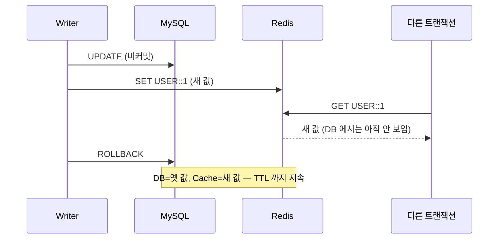

# Write Update

DB 가 바뀌면 캐시를 **지우지 않고 새 값으로 덮어쓰는** 전략이다(`@CachePut`).
다른 모듈은 모두 삭제를 쓴다. 이 모듈은 그 선택의 근거를 반대편에서 증명하는 대조군이다.

이 모듈이 증명하려는 명제는 하나다.
**롤백되면 DB 와 캐시가 어긋나고, 그 어긋남이 TTL 동안 지속된다.**

## Environment

- Java 21
- Spring Boot 3.5.0
- Hibernate 6.6.15.Final
- MySQL 8.4.4
- Redis 7

## 동작



`@CachePut` 은 메서드가 **반환되는 순간** 적재한다. 바깥 트랜잭션에 참여하면 커밋보다 먼저 적재되고,
롤백은 캐시를 되돌리지 않는다.

## 구성

| 클래스 | 역할 |
|-------|-----|
| `user/UserCommandService` | `changeEmail` 에 `@CachePut`. 반환값이 조회 모델 `UserView` 다 |
| `user/UserQueryService` | `@Cacheable` 만 선언한다 |
| `config/*` | [ttl-only](../ttl-only/README.md#설정) 와 같은 설정을 복사해 직접 선언한다 |

쓰기 메서드가 `UserView` 를 만들어 돌려줘야 한다. **쓰기 경로가 조회 모델의 조립을 안다**는 뜻이다.
캐시 값이 여러 테이블의 조합이면 쓰기마다 그 조합을 다시 해야 한다
→ [why-invalidate-not-update](../docs/concepts/why-invalidate-not-update.md)

등록과 삭제에는 캐시를 걸지 않는다. 이 모듈의 관심은 갱신이다.

### 삭제는 갱신으로 처리할 수 없다

지운 데이터에는 덮어쓸 새 값이 없다. 그래서 갱신 전략도 삭제는 **무효화**로 처리하는 것이 표준이다.

| 형태 | 수정 | 삭제 |
|-----|-----|-----|
| 애플리케이션 갱신 (Spring) | `@CachePut` | `@CacheEvict` |
| 정통 Write-Through (Coherence 등) | `put` → `CacheStore.store` | `remove` → `CacheStore.erase` |

삭제 경로에 아무것도 걸지 않으면 지운 사용자가 **TTL 동안 계속 조회된다.**
이는 갱신 방식의 어긋남이 아니라 무효화가 없는 것이고, [ttl-only](../ttl-only/README.md) 와 같은 상태다.
`@CacheEvict` 를 걸면 롤백되어도 미스 1회로 끝나지만, [write-invalidate](../write-invalidate/README.md) 의 커밋 전 삭제 문제는 그대로 따라온다.

## 테스트가 고정한 동작

| 상황 | 결과 |
|-----|-----|
| 쓰기가 트랜잭션을 직접 소유 | 변경 직후 조회가 새 값을 반환하고 **DB 를 읽지 않는다** (삭제 방식 대비 MISS 1회 절약) |
| 바깥 트랜잭션 참여, 커밋 전 | 다른 트랜잭션이 DB 에서는 안 보이는 미커밋 값을 **캐시로 읽는다** |
| 바깥 트랜잭션 롤백 | DB 는 옛 값, 캐시는 새 값. 이후 조회도 일어나지 않은 변경을 돌려준다 |

`@CachePut` 을 `@CacheEvict` 로 바꾸면 첫 행의 "새 값 반환" 을 뺀 네 테스트가 실패한다.
테스트가 덮어쓰기와 삭제를 구분한다는 확인이다.

어드바이저 순서(캐시와 트랜잭션 중 어느 쪽이 바깥인가)는 고정하지 않는다.
[write-invalidate](../write-invalidate/README.md) 와 같은 이유로, 바깥 트랜잭션 경계로 재현한다.

## 실행

```bash
./gradlew :spring-cache:cache-invalidation-strategy:write-update:test
./gradlew :spring-cache:cache-invalidation-strategy:write-update:test -Ptestcontainers
```

## 언제 이 전략이 나은가

| 적합 | 부적합 |
|-----|-------|
| 캐시가 단일 엔티티와 1:1 | 캐시가 여러 소스의 조합 |
| 쓰기 직후 조회가 매우 잦다 | 롤백이 일어날 수 있는 쓰기 |
| 롤백이 사실상 없다 | 바깥 트랜잭션에 참여하는 쓰기 |

## 관련 문서

- [docs/write/write-through.md](../docs/write/write-through.md)
- [docs/concepts/why-invalidate-not-update.md](../docs/concepts/why-invalidate-not-update.md)
