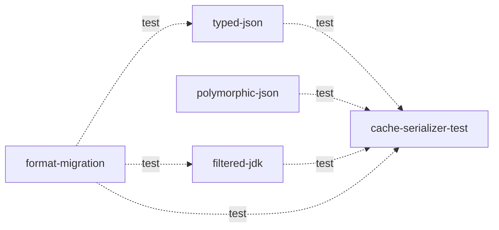

# Cache Serializer Strategy

Redis 캐시 값 직렬화기를 **무엇을 내주고 무엇을 얻는가**로 비교하고, 그 명제를 전략별 하위 모듈의 테스트로 고정한다.
캐시 무효화·TTL·JPA 는 다루지 않는다. 그쪽은 [cache-invalidation-strategy](../cache-invalidation-strategy/README.md) 가 맡는다.

## 결론

| 상황 | 선택 |
|-----|-----|
| 새로 짜거나 일반 애플리케이션 캐시 | 캐시마다 값 타입을 선언한 **타입 고정 JSON**, 값은 조회 결과 DTO(record) |
| 한 캐시에 여러 타입이 정말 섞임 | **타입 지명 JSON** + 허용 목록 |
| JDK 로 엔티티를 캐싱 중 | 먼저 **역직렬화 필터**로 막고, 캐시 하나씩 DTO + 타입 고정 JSON + 캐시 이름 버전업으로 옮긴다 |

## 모듈

| 모듈 | 전략 | 보안 등급 | 공개 API |
|-----|-----|---------|--------|
| `typed-json` | 타입 고정 JSON (`Jackson2JsonRedisSerializer<T>`) | 안전 — 값에 타입 정보가 없다 | `TypedJson` |
| `polymorphic-json` | 타입 지명 JSON (`GenericJackson2JsonRedisSerializer`) + 허용 목록 | 주의 — 값이 복원 클래스를 지목한다 | `PolymorphicJson` |
| `filtered-jdk` | JDK 직렬화 + 캐시 전용 `ObjectInputFilter` | 위험 등급을 필터로 좁힌다 | `FilteredJdk` |
| `format-migration` | JDK → 타입 고정 JSON 이관 (dual-read, 캐시 이름 버전업) | 구 값은 필터를 건 JDK 로만 읽는다 | `FormatDetectingSerializer` |
| `cache-serializer-test` | 전략 모듈이 공유하는 테스트 픽스처 | — | — |



전략 모듈끼리는 제품 코드로 의존하지 않는다. `format-migration` 은 이관 대상인 두 전략을 테스트에서만 조합한다.

## 증명하는 명제

| 모듈 · 테스트 | 명제 |
|-------------|-----|
| `typed-json` · `TypedJsonTest` | 값에 클래스 이름이 없다 · 쓴 클래스가 이동·개명돼도 읽는다 · 모르는 필드를 무시한다 · 원소 타입 없이 선언한 컬렉션은 원소가 `Map` 으로 돌아온다 · 양방향 참조는 저장에 실패한다 |
| `polymorphic-json` · `PolymorphicJsonTest` | 값에 `@class` 가 실린다 · 타입 정보 없는 JSON 보다 크다 · 허용 목록 밖 클래스는 생성자가 돌기 전에 거부한다 · 쓴 클래스가 패키지를 옮기면 이전 값을 못 읽는다 |
| `filtered-jdk` · `FilteredJdkTest` | 필터가 없으면 읽기만으로 `readObject` 가 실행된다 · 필터는 그 전에 거부한다 · `Serializable` 을 구현한 record 는 왕복된다 · 양방향 참조를 그대로 복원한다 · 필드 이름이 값에 실린다 · 같은 값의 JSON 보다 크다 |
| `format-migration` · `FormatDetectingSerializerTest` | 첫 두 바이트로 구 포맷을 가른다 · 구 값은 새 타입으로 바꿔 돌려주고 센다 · 쓰기는 새 포맷만 · 깨진 값을 구 포맷으로 위장하지 않는다 |
| `format-migration` · `RollingMigrationTest` | 캐시 이름을 올리면 신 Pod 는 구 바이트를 읽지 않는다 · 이름을 두고 직렬화기만 바꾸면 신 Pod 가 실패한다 · 구 Pod 의 삭제는 신 이름의 키에 닿지 않는다 |

## 실행

```bash
./gradlew :spring-cache:cache-serializer-strategy:typed-json:test \
          :spring-cache:cache-serializer-strategy:polymorphic-json:test \
          :spring-cache:cache-serializer-strategy:filtered-jdk:test \
          :spring-cache:cache-serializer-strategy:format-migration:test
```

`RollingMigrationTest` 는 로컬 Redis(`localhost:6379`)가 필요하다. 없으면 건너뛴다.
Redis: `_settings/docker/docker-compose.yml`

## 관련

- Redis 캐시 직렬화기 선택 가이드 (artifact) — 이 모듈이 고정하는 명제의 근거와 이관 절차
- [cache-invalidation-strategy/docs/concepts/serialization.md](../cache-invalidation-strategy/docs/concepts/serialization.md)
